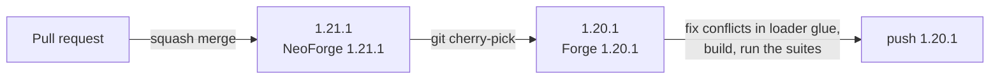

# Contributing

Thanks for helping with Create: Octo Arms. This page explains how to build the mod and how to send changes.

## Before you start

- **Small fix?** Open a pull request.
- **Big feature or behaviour change?** Open an issue first, so we can agree on the design before you write code.
- Read the [glossary](docs/CONTEXT.md). Code, comments, lang text and issues use its terms (Tentacle Rig, Tentacle, Grip, Held, Reach, Air, Active, Stowed, Double Jump, Setting Down, Crawl, Rig Block, ...).

## Ground rules

- Be kind. The [Code of Conduct](CODE_OF_CONDUCT.md) applies to issues, pull requests and discussions.
- Everything is in English: code, comments, commits, issues.
- One topic per issue or pull request. Unrelated refactors, reformatting or dependency bumps go in their own pull request, or not at all.
- No new required dependencies, and no bundled mods or libraries, without an issue agreed first. Create stays the only required dependency.
- Keep the mod's style: Create-like look, glossary names, no features that only work on a client or only on a server.
- Code made with AI tools is fine, but you must understand it and test it in game before you send it. Untested pull requests are closed.
- Do not open pull requests only to change versions, wording or formatting.
- Security problems go through [SECURITY.md](SECURITY.md), not a public issue.

## Branches

| Branch | Build | Version, tag |
|---|---|---|
| `1.21.1` | NeoForge 21.1, MC 1.21.1, Java 21 | `X.Y.Z`, `vX.Y.Z+mc1.21.1` (bare `vX.Y.Z` up to 1.5.0) |
| `1.20.1` | Forge 47, MC 1.20.1, Java 17, no Sable Ships, no in-game config screen | `X.Y.Z`, `vX.Y.Z+mc1.20.1` |
| `main` | frozen at 1.5.0, history and links only | none |



- Fixes and features land on `1.21.1` first, then the maintainer cherry-picks them onto `1.20.1`.
- Both branches carry the same `mod_version` for the same changes; jars and tags add `+mc<minecraft version>` (rules in [docs/RELEASE.md](docs/RELEASE.md)).
- `CHANGELOG.md` is one file, identical on both branches. A line for one platform starts with `**1.20.1 only:**` or `**1.21.1 only:**`; untagged lines apply to all. Cherry-pick changelog lines verbatim, never reword them on one branch.
- Send a pull request against the branch of the version it changes: `1.21.1` for almost everything, `1.20.1` only for a bug that exists only on 1.20.1. Never against `main`.
- File names and class layout are the same on both branches, so cherry-picks apply. Do not rename or move files on one branch only.
- Expected conflicts are the loader glue: `Tentaworks`, `TentaworksClient`, `TentaworksNetwork`, `RigEnchants`, `RigSettings` (NBT vs data component), the vertex calls in `TentacleRenderer`, `TentacleLayer`, datagen, `tentaworks.mixins.json`, build files and the docs. Logic in `rig/` usually applies clean.
- `1.20.1` is Java 17: a cherry-picked change with Java 21 features (record patterns in `switch`, `List.getFirst()`, ...) needs a rewrite there.

## Build and run

You need **JDK 17 or newer** on `1.20.1` (Gradle uses a Java 17 toolchain), **JDK 21 or newer** on `1.21.1`.

```sh
./gradlew build        # builds build/libs/octo-arms-<version>+mc1.20.1.jar, runs the tests
./gradlew test         # unit tests, plus fmlTest (tests that need Forge and Create, run in a dev server)
./gradlew runClient    # dev client
./gradlew runServer    # dev server
./gradlew runData      # regenerates src/generated (lang, blockstates, models, recipes, tags)
```

`runClient` and `runServer` also load the `dev` source set (dev-only commands and test tools). They are not in the release jar.

New text must reach all 15 languages before a release (`python3 tools/lang_check.py`, rules in `docs/RELEASE.md`). Lang files, blockstates, item models, recipes and tags in `src/generated/` are generated. Do not edit the JSON by hand: change `TentaworksLang` or the classes in `dev.tentaworks.data` (`TentaworksDatagen`, `TentaworksMechanicalCraftingRecipes`, `TentaworksSequencedAssemblyRecipes`), then run `./gradlew runData` and commit the result.

## Code style

- Java 21 on `1.21.1`, Java 17 on `1.20.1`. Match the style of the code around your change.
- No unnecessary comments. Write a comment only when it tells the reader something the code can't.
- Use the glossary terms in names and player-facing text.
- Keep changes focused. One topic per pull request.

## Frozen IDs (save compatibility)

Worlds store some strings. **Never rename or remove them**, or existing worlds lose Rigs, Rig Blocks, enchantments or settings:

- the mod id `tentaworks`
- block, item, enchantment, data component and display source registry names
- block state properties
- NBT keys and data component field names (on `1.20.1` the Rig's data lives in stack NBT with the same field names)
- config keys

The full list is in [docs/save-format.md](docs/save-format.md). Code constants live in `src/main/java/dev/tentaworks/TentaworksIds.java`. Adding new ids is fine. If you really must change a saved format, add a migration and say so clearly in the pull request.

The network protocol version is also bumped whenever packets change, so mixed client/server versions can't join each other.

## Testing

There is a scripted test harness in `tools/` (headless suites, client screenshot scripts, metrics). The full run is `tools/run_all.sh <tag>`.

At minimum, before a pull request:

1. `./gradlew build` passes.
2. You tested your change in game (client, and dedicated server if it touches networking, Air or movement checks).
3. For movement changes, run the harness suites and compare with the numbers in [docs/phase-notes.html](docs/phase-notes.html).

## Pull requests

1. Fork the repo and create a branch from `1.21.1` (from `1.20.1` only for a bug that exists only there).
2. Keep the pull request small and about one thing.
3. Describe **what** changed, **why**, and **how you tested it** (client or server, screenshots for visual changes).
4. Add a line to `CHANGELOG.md` under `[Unreleased]`, starting with `**1.20.1 only:**` or `**1.21.1 only:**` when it applies to one platform.
5. Be ready for review comments.

## Review and merge

- Only the maintainer (@SenDeliver) reviews and merges. `1.21.1` and `1.20.1` accept pull requests only; squash merge into that branch; release tags are made by the maintainer.
- The **Build** check (`./gradlew build` on GitHub Actions) must pass before a pull request is merged.
- Expect a first answer within about a week. Pull requests with no reply to review comments for 30 days may be closed, you can reopen later.
- Accepted changes land in the next release and get a line in `CHANGELOG.md` with your GitHub name.
- The maintainer may decline a change that does not fit the mod's goals, even if the code is fine. Open an issue first for anything big to avoid wasted work.

By contributing, you agree that your work is released under the [MIT License](LICENSE).
