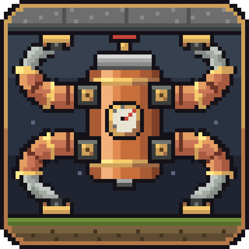
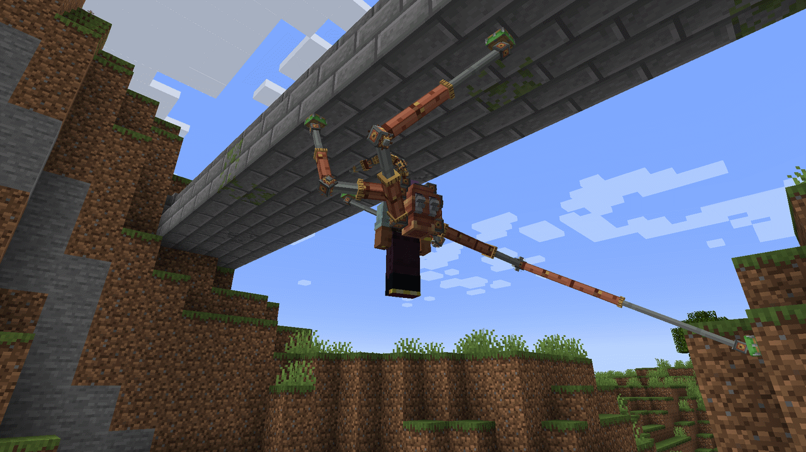
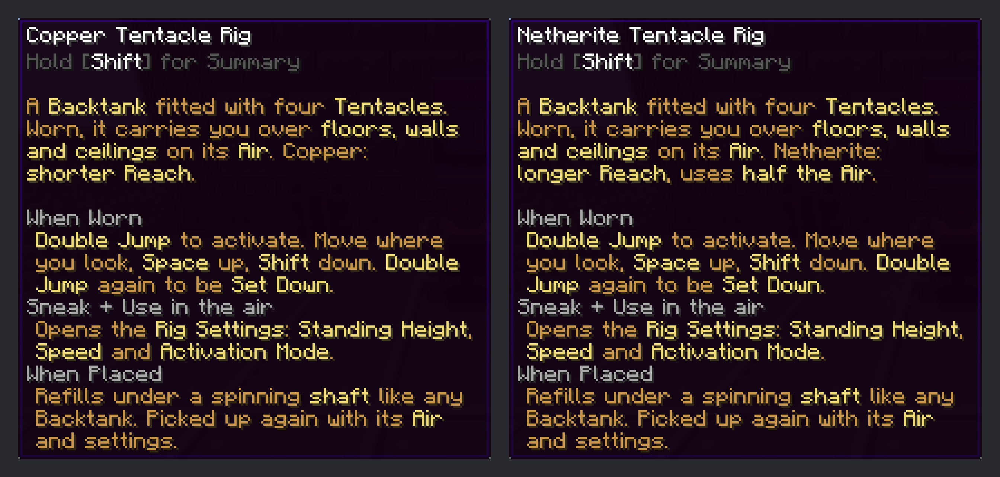
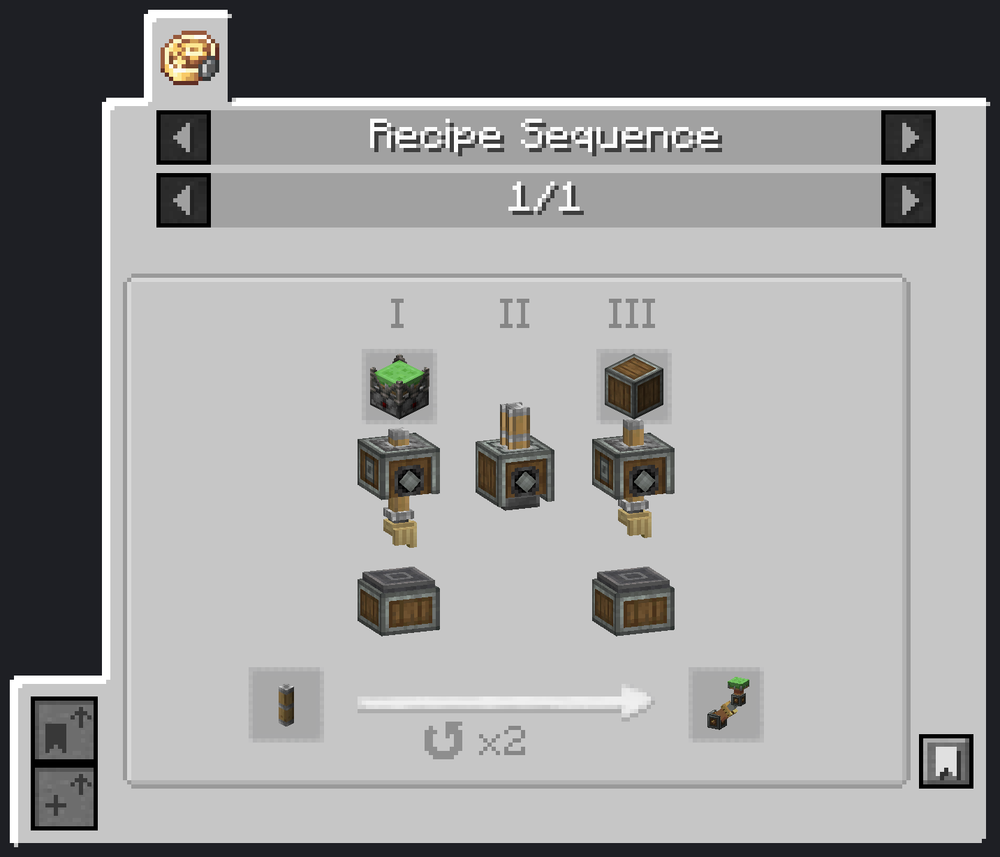
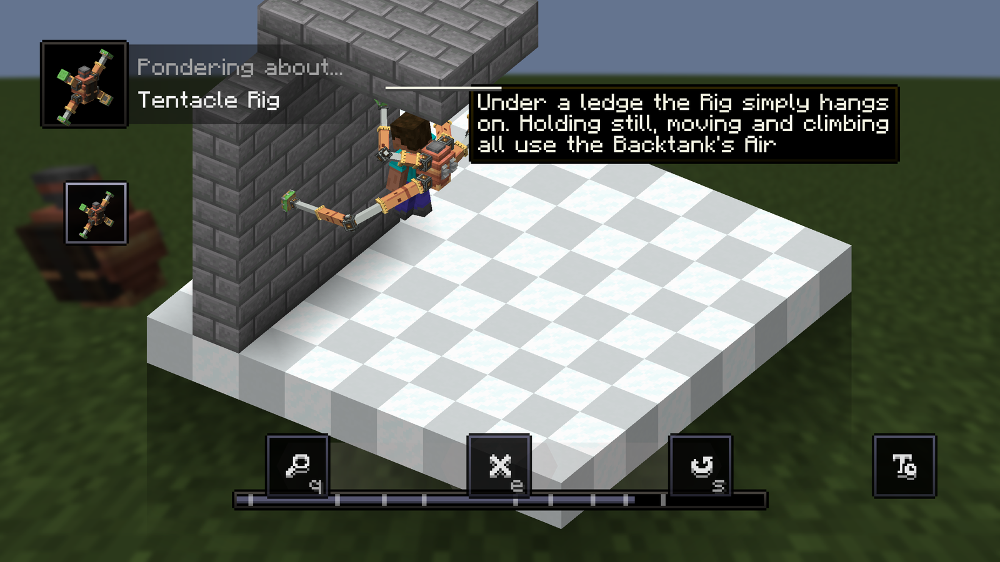
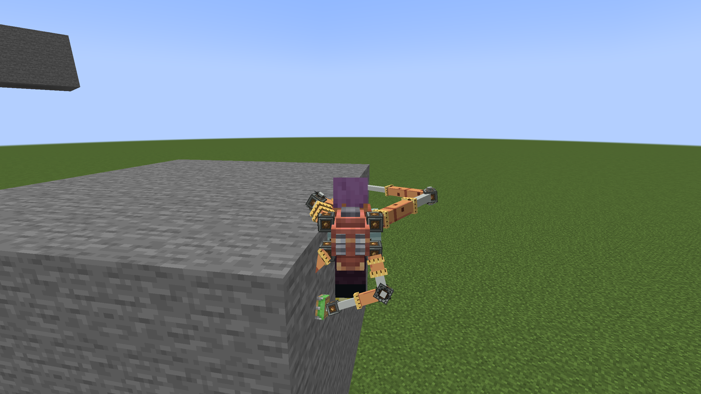

<p align="center">
  
</p>

# Create: Octo Arms

Fit four pneumatic Tentacles to a Create Backtank and let them carry you over floors, walls and ceilings. Fit two Actuators on top and it also mines, builds, fights, grabs and throws at a distance. Doc Ock style.

For Minecraft **1.21.1** (NeoForge) and **1.20.1** (Forge), see [Downloads](#downloads).

[](LICENSE)
[](https://www.minecraft.net/)
[](https://neoforged.net/)
[](https://github.com/Creators-of-Create/Create)


## What it does

Craft a **Tentacle Rig**: a Backtank with four **Tentacles** and a Precision Mechanism. Wear it in the chest slot and **Double Jump**. The Tentacles grab nearby block faces and carry you where you look: across the floor, up a wall, under a ledge or a ceiling. Your hands stay free, so you can mine, build and fight while you hang.

The Rig runs on the Backtank's **Air**. Holding still uses a trickle, moving uses more, climbing the most. Place the Rig as a block under a spinning shaft to refill it, like any Backtank. Double Jump again and the Rig **Sets you Down** on the floor.

New in 2.0: fit two **Actuators** to the Rig. Each one stands in for a hand and does whatever that hand does, farther (**Far Use**); with a tool in each they work together (**Dual Wield**); a free one **Grabs** a mob, holds it out of your way, sets it down where you look or **Throws** it. See [Actuators](#actuators).

The only required dependency is Create. With Sable (optional) the Rig also grips and rides Ships. The terms used here (Tentacle Rig, Grip, Reach, Air, Crawl, ...) are explained in the [glossary](docs/CONTEXT.md).

## Features

- **Climb anything solid**: Tentacles grip any full block face: floor, wall, ceiling, the underside of a ledge, also underwater.
- **Ride Ships**: with Sable (or Create Aeronautics) installed, Tentacles grip Ship blocks too and the Rig carries you along with a moving, turning Ship. See [Ships](#ships-sable--create-aeronautics).
- **Move where you look**: forward follows the camera (also up and down), `Space` goes up, `Shift` goes down. You can't walk off an edge: the Rig only moves you where at least two Tentacles can hold.
- **Hang** under ledges and ceilings, as long as you like.
- **Double Jump** to activate, also in mid-air: the Rig catches you as soon as a Grip is in Reach, with no fall damage.
- **Setting Down**: Double Jump again and the Rig lowers you to the floor and folds up. With no floor in Reach, it lets go at the lowest point it can hold.
- **Crawl**: out of Air, the Rig does not drop you. It slowly lowers you to the nearest floor, then folds up.
- **Hands free**: mining, placing, fighting and using items all work while the Rig carries you. `Shift` also sneaks, so sneak + right click works, without the crouch.
- **Actuators** (2.0): two extra arms above the Tentacles, fitted at a crafting table. **Far Use** mines, places, hits and uses out to the Rig's Reach; **Dual Wield** adds the off-hand tool or weapon; **Grab** (`V`) takes a mob with any free Actuator, **Throw** flings it with Impact damage. With Sable, **Ship Grab** lifts a whole Ship. See [Actuators](#actuators).
- **Still a Backtank**: it holds Air (twice as much as the Backtank it was made from), feeds a Diving Helmet, takes Capacity and refills under a shaft.
- **Keep your chestplate**: with [Curios](https://www.curseforge.com/minecraft/mc-mods/curios-continuation) installed the Rig also fits the back slot. There it is a Rig and not armor: everything works, it gives no armor value and armor enchantments on it are idle. See [Curios](#curios-back-slot).
- **Two tiers**: Copper (Reach 5) and Netherite (Reach 7, half the Air use, fire resistant).
- **Five own enchantments**: Far Reach, Thrift, Swift, Silent Step and Deft, plus vanilla chest armor enchantments and Create's Capacity.
- **Never breaks**: like an Elytra, a worn-out Rig stops working at 1 durability until you repair it. Air, enchantments and settings are kept.
- **Rig Settings** screen: Standing Height, Speed, Activation Mode (Double Jump or a key) and, on a fitted Rig, Far Use.
- A stepping gait everyone on the server sees, with Sticker and piston sounds.
- Create-style tooltips, a Ponder scene, Engineer's Goggles info, a Display Link source and JEI recipes.

| Climbing a wall | Hanging under a ceiling |
|---|---|
|  |  |

## Items and blocks

| Item / block | What it is | How to get it |
|---|---|---|
| **Tentacle** | One pneumatic arm. Four go into every Rig. Tier-less. | Sequenced Assembly on a Piston Extension Pole: deploy Sticker, press, deploy Andesite Casing, 2 loops |
| **Incomplete Tentacle** | Transitional item of the Tentacle sequence | — |
| **Copper Tentacle Rig** | Worn Rig, Reach 5 blocks, normal Air use, 112 durability | Mechanical Crafting (see below) with a Copper Backtank |
| **Netherite Tentacle Rig** | Worn Rig, Reach 7 blocks, half the Air use, 592 durability, fire resistant | Mechanical Crafting with a Netherite Backtank, or Smithing: Copper Tentacle Rig + Netherite Upgrade + Netherite Ingot (keeps Air) |
| **Actuator** | One pneumatic arm that acts instead of walking. Two fit on a Rig. Tier-less. | Sequenced Assembly on a Piston Extension Pole: deploy Brass Casing, press, deploy Sticker, 2 loops |
| **Incomplete Actuator** | Transitional item of the Actuator sequence | — |
| **Fitted Rig** (Copper / Netherite) | The same Rig with two Actuators. Not a separate item: the tooltip says "Actuators fitted". | A Rig between two Actuators in one row of a crafting table (keeps Air, enchantments, settings and damage), or the fitted Mechanical Crafting recipe |
| **Rig Block** (Copper / Netherite) | A Rig placed in the world. Refills under a spinning shaft, like a Backtank. Not a separate item: place the Rig, pick it up again. | Use a Rig on a block |

Mechanical Crafting pattern for both Rigs (3×3): Tentacles in the four corners, Precision Mechanism top centre, Brass Casing left and right, the Backtank in the centre, a Copper Sheet bottom centre. The fitted variant is the same pattern 5 wide, with an Actuator at each end of the middle row. Check JEI for the exact recipes.

Advancements, all under Create's Backtank advancement:

| Advancement | How |
|---|---|
| **Doc's Rig** | Get your first Rig |
| **Fitted** | Fit two Actuators to a Rig |
| **Hang In There** | Hang under a ceiling for a whole minute |
| **Spider, Man** | Kill a spider with the Rig out |
| **Intelligence Is a Privilege** | Put Far Reach, Thrift, Swift, Silent Step and Deft on one Rig |
| **The Power of the Sun** | Grab a Blaze |
| **Special Delivery** | Throw a mob so it lands 20 blocks or more away |
| **Fridge Mover** | Grab a Ship and set it down 50 blocks from where you took it (1.21.1 with Sable only) |

| Tooltips | Sequenced Assembly in JEI |
|---|---|
|  |  |

## How to use

1. **Craft Tentacles** on a Sequenced Assembly line, then the **Rig** on Mechanical Crafters. A new Rig starts with **no Air**.
2. **Fill it**: use the Rig on a block to place it (Rig Block), put a spinning shaft above it and wait. Use it with an empty hand to pick it up again; Air, enchantments and settings stay on the item.
3. **Wear it** in the chest slot (it replaces your chestplate, like a Backtank), or with Curios in the back slot and keep your chestplate (use the Rig while wearing a chestplate and it goes there). One Rig at a time.
4. **Double Jump** (press jump twice quickly) to activate. The Rig lifts you to your Standing Height.
5. **Move**: look where you want to go and walk. `Space` = up, `Shift` = down. Look up at a wall and walk into it to climb it. Walk under a ledge to hang under it.
6. **Double Jump again** to be Set Down.
7. **Watch your Air**. Copper Rig: about 1 Air per 4 s holding still, 1 per second moving, 2 per second climbing. The Netherite Rig uses half. A Backtank holds 900 Air and a Rig twice its Backtank (1800), more with Capacity. A Rig from before 2.0 shows its Air bar half full until it is refilled once. At 0 Air the Rig **Crawls** you down to the floor.
8. **Rig Settings**: sneak + use the Rig in the air, or bind the **Rig Settings** key (unbound by default) to open them while wearing it. Set Standing Height (0 to Reach, default 1.5 blocks), Speed (walk speed up to the server's top Speed, default the top Speed) and Activation Mode; a fitted Rig adds Far Use. In "key only" mode, bind **Toggle Tentacle Rig** in Controls and use it instead of the Double Jump.
9. **Enchant** it at an enchanting table or anvil:
   - **Far Reach** I–III: +1 block of Reach per level.
   - **Thrift** I–III: −15 % Air use per level.
   - **Swift** I–II: +15 % Speed and top Speed per level.
   - **Silent Step**: with the Rig out, Sculk Sensors, Shriekers and Wardens do not hear you (steps, blocks, items) and the Rig makes no sound.
   - **Deft**: the Actuators use no Air. Does nothing on a Rig without Actuators.
   - Also Protection (all kinds), Unbreaking, Mending, Thorns and Create's Capacity.
10. **Repair** a worn-out Rig at an anvil with a Copper Ingot (Copper Rig) or Netherite Ingot (Netherite Rig), or with Mending. The tooltip turns red when it is worn out.

**Creative mode**: a worn Rig uses no Air. The Double Jump goes to the Rig; press jump a third time while Active, or use the fly key, to switch to creative flight.

**Falling**: if the blocks under your Grips are broken and no new Grip is in Reach, you fall with normal fall damage until the Rig finds a Grip again. Taking the Rig off, logging out or changing dimension folds it at once.



Ponder (hold `W` over a Rig or Tentacle) shows all of this step by step.

## Actuators

New in 2.0. Two Actuators sit on the Rig above the Tentacles, one for each hand: the one on your main-arm side is the main-hand Actuator, the other the off-hand Actuator (left-handed players get them the other way round). Each carries its hand's item, in first and third person, and does everything that hand does while your own arms stay still. The Tentacles keep walking exactly as before; the Actuators act on the world. They work wherever your hands work: Stowed or Active, on a Ride, gliding, Falling. Fitting is optional and permanent: a Rig without Actuators is a complete Rig that only walks, and a Rig from before 2.0 is one of those until you fit a pair.

**Getting them**

1. **Craft Actuators** on a Sequenced Assembly line: Piston Extension Pole, deploy Brass Casing, press, deploy Sticker, 2 loops. One kind for both tiers.
2. **Fit two** to a finished Rig: Actuator, Rig, Actuator in one row of a crafting table. The Rig keeps its Air, enchantments, Rig Settings and damage. Or build a fitted Rig in one go on Mechanical Crafters (the Rig recipe with an Actuator added on each side).
3. A fitted Rig is named **Copper Octo Rig** or **Netherite Octo Rig**. Smithing a fitted Copper Rig to Netherite keeps the Actuators. The first time you wear a freshly fitted Rig, both Actuators unfold and flex.

**Far Use**

- Whatever either hand does, farther: mining, placing, hitting and using items. The hand's Actuator does it at its tip, with the item in that hand, near or far.
- Blocks, mobs and players: out to the Rig's Reach (Copper 5, Netherite 7, Far Reach adds), with any item, weapon or tool. Reach is measured from the Rig body, like a Tentacle's Grip: what a Tentacle can hold on to, an Actuator can work on, the floor around you included.
- Past arm's length the server checks the target is in sight of your eye: nothing is reached through a wall, a pane or the floor.
- Only an action past arm's length that does something costs Air: a lever flipped, a block placed, a mob hurt, a block that starts to break. An empty hand on stone does nothing, as it would by hand.
- Drops and XP of a block mined by Far Use fly to you.
- With an Extendo Grip in hand the Rig adds no reach.
- Rig Settings row **Far Use**: Always (default), Rig out only, or Off.

**Dual Wield**

- With both Actuators free, the off-hand item works along with the main-hand one.
- Mining: two tools that both suit the block (two axes on a log, two pickaxes on stone) break it at the sum of their speeds, each with its own Efficiency, and both wear. An off-hand tool alone does the work, gets its drops and takes the wear; the main-hand item takes none. Fortune and Silk Touch stay the main hand's.
- Melee: the off-hand weapon or tool adds its damage and its damage enchantments to the hit, scaled by your attack strength, and wears.
- Each block broken or hit landed this way costs 0.5 Air on a Copper Rig. Item use is not sped up.
- Not while the off-hand Actuator holds a mob, during a heavy hold, or without Air. Server config `actuators.dualWield` turns it off.

**Grab and Throw**

- Press **Grab** (`V`, rebindable; Curios keeps `G`) while looking at a mob within Reach and in sight. A free Actuator takes it: the off-hand one if your off hand is empty, else the main-hand one if your main hand is empty. It holds the mob low on its side, out of the crosshair. While you look at something grabbable, the Actuator that would take it points at it.
- Your other hand keeps working while one Actuator holds: mine, fight, place, open doors. An item that lands in the holding Actuator's hand sets the mob down.
- The held mob is **Pinned**: no attacks, no Creeper fuse, no spells or shots. You can still shear, milk, name, saddle or leash it.
- **Tap `V`** to set it down where you look: on top of the block under the crosshair, or beside its side and down to the floor. An outline shows the spot, red when the mob does not fit there or the spot is out of Reach or out of sight; with no valid spot it is set down where it hangs. It stays calm for one second; looking at a seat, boat or minecart puts it in.
- **Hold `V` and turn the mouse wheel** to move it nearer or farther, half a block a notch, out to Reach. The hotbar does not scroll meanwhile.
- **Attack** while holding **Throws** it along your view (Netherite faster). With an item in the main hand a plain attack uses the item, so hold `V` and attack to Throw. A thrown mob takes fall damage and **Impact** damage when it slams into a block or another mob, which is hurt too. Impact counts as your damage (loot, XP and protection rules see you) and hurts players only where PvP allows.
- Light mobs (up to 1.5 blocks wide and 2 tall: zombie, villager, cow, spider) take one Actuator. Heavy ones (Iron Golem, Ravager, Horse, Enderman, Ghast) take both and need both hands empty: Far Use pauses and you move at 60% speed while you hold them (Rides and glides unaffected).
- Never: players, bosses (Ender Dragon, Wither, Warden, anything over 100 max health, the `tentaworks:bosses` entity tag), anything riding or ridden, anything another wearer holds or another player has on a lead, or another player's pet unless the server allows it. Claim and protection mods are asked first. A refused Grab says why in the action bar (hands full, needs both Actuators, boss, owned, out of sight, out of Reach, no Air).
- The hold lasts through Stowing, Setting Down, Rides, gliding and Falling. It ends on Crawl, death, logout, taking the Rig off, a dimension change, the target gone or out of Reach, or no Air left: the target is set down where it is.

**On screen**

- Crosshair marks (first person): a claw mark beside the crosshair when an Actuator will reach what you look at, on the acting side, in the tier's colour (copper or netherite purple); both sides when Dual Wield applies; a hollow pair when the target is just out of Reach, flashing when a click or a Grab lands on nothing for that reason; red when the Actuators are out of Air. The marks pulse with every strike.
- Each bracket is one Actuator (the left bracket is the left one). While an Actuator holds, its bracket is shut tight against the crosshair, both for a heavy hold; it goes pale over a spot the mob cannot be set down on. With `V` down a small column of ticks beside it shows the hold distance, the lit tick moving with the wheel.
- Above the crosshair: an open claw over a mob a free Actuator can take, or a glyph for why not (needs both Actuators, hands full, refused). No words at the crosshair: press `V` anyway and the action bar says why.
- Key hints, for the first two holds of a game session: the Grab key beside the open claw, and after a Grab one action-bar line with your keys for Set Down, Throw and the hold distance. Client config `hud.hints` turns them off.
- A small HUD line by the hotbar shows what you hold (and "heavy") and when the Actuators are out of Air.
- Hidden with F1 and in third person; client config `hud.crosshair` turns the crosshair marks and cues off.

**Ship Grab** (1.21.1 with Sable only): `V` on a block of a Ship, with both hands empty, takes the whole Ship in both Actuators. It stays where it was in your view: look around and it swings round you, turn and it turns with you (its tilt stays); `V` with the wheel moves it nearer or farther, a tap of `V` lets it go, attack throws it. Needs a Ship of scale 1 within the tier's mass cap (Copper 2000, Netherite 6000 Sable mass), nobody else on board, and not the Ship you stand on or hang from. Server config `grab.ships` (and `ships.grip`) turn it off.

**Air and Deft**

The Actuators drink lightly from the Rig's Air. Copper Rig: 0.5 Air per Far Use action, 0.5 per Dual Wield block or hit, 1 Air per 2 s of holding, 10 Air per Throw; Netherite half, Thrift less. With no Air left the Actuators hang limp and a held target is set down. The **Deft** enchantment makes them free. Creative players use no Air.

**Look**

At rest the Actuators curl up above your head, wider than your body, so they frame you without blocking the third-person view, breathing with small idle gestures; the acting one leans toward a far target before you click. Work shows at the tip, in step with your swing: strikes that follow the crosshair from block to block, both Actuators in turn for Dual Wield, a thrust for placing and using, held items raised as you use them (eating, a shield, a bow). In first person they enter from the edge of the view and stand in for both hands. Client config `firstPerson.limbOpacity` draws every Limb (Tentacles and Actuators) in first person from solid (1.0, default) down to faint (0.1). A Throw kicks the camera, an Impact clanks.

## Compatibility

- **Ponder** (comes with Create): one scene, "Tentacle Rig", in the "Tentacle Rigs" tag: crafting, refilling, Double Jump, walking, climbing, hanging, Setting Down and Crawl.
- **Engineer's Goggles**: on a Rig Block they show Air, the fill rate (or "needs a turning shaft above"), Reach, Top Speed and Air use. The Rig item tooltip shows the same stats.
- **Create Display Link**: a Rig Block is a Display Link source, "Rig Air" (Air number, percent or progress bar). Works with Display Boards and Nixie Tubes.
- **JEI** (optional): all recipes show up in Create's own categories (Sequenced Assembly, Mechanical Crafting), in vanilla Smithing and, for Fitting, in vanilla Crafting.
- **Claim and protection mods**: a Grab asks the loader's entity-interaction event first, so they can refuse it. Far Use goes through the vanilla block and entity events, which they already guard.
- **Jade**: no special support.
- **Sable / Create Aeronautics** (optional, not needed): Ship blocks are Grips and the Rig rides moving Ships. See [Ships](#ships-sable--create-aeronautics).
- **Curios** (optional): the Rig fits the back slot. See [Curios](#curios-back-slot).
- Tested together with Elytra Slot, Sophisticated Backpacks and Carry On.


## Curios back slot

With Curios installed (1.21.1: Curios 9.2.0 or newer; 1.20.1: Curios 5.3.0 or newer) both Rigs fit the `back` slot and players get that slot from this mod. A Rig in the back slot is a Rig, not armor:

- Works: Air (also for a Diving Helmet and the air HUD), Reach, Far Reach, Thrift, Swift, Silent Step, Capacity, Rig Settings, the Rig Settings key, Mending, repair at an anvil. Hits wear it like chest armor, it never breaks.
- Does nothing: armor value, armor toughness, knockback resistance, Protection and its kinds, Thorns. The tooltip says so.
- One Rig at a time. The back slot refuses a Rig while the chest slot holds one and the chest slot refuses a Rig while the back slot holds one. If both end up with a Rig anyway, the chest Rig wins and the other does nothing (red tooltip).
- Using a Rig from the hand: empty chest slot, it is worn as armor as before; a chestplate on and a free back slot, it goes to the back slot; otherwise the usual armor swap.
- Elytra in the chest slot and the Rig in the back slot: the Elytra never opens while the Rig is out; Set Down, then jump and glide.
- Server owners who want to keep the chestplate trade-off set `curios.backSlot = false` in the server config.

## Ships (Sable / Create Aeronautics)

New in 1.1.0. With Sable installed, blocks of a Ship are Grips like world blocks. Create Aeronautics is not needed, but Aeronautics Ships are Sable Ships, so they work too. Without Sable nothing changes.

- Grip a Ship's floor, walls, hull or underside, parked or moving.
- A Held wearer is carried with the Ship, also around its turns. The Ship that holds most of your Grips carries you.
- Move freely between world blocks and a Ship, both ways.
- Air use counts only your own move, not the Ship's.
- Standing on the deck works as before: Sable moves you, the Rig adds nothing on top.
- If the Ship is removed while you hang on it, you fall, as when blocks under your Grips break.
- With Actuators fitted, Grab a whole Ship and carry or throw it: [Ship Grab](#actuators).
- Server admins can turn it off: `ships.grip = false` (see [Config](#config)).

Tested: parked and turned 30°, moving at 4 and 15 blocks/s, turning at 20°/s while rolling 10°/s, moving between world and Ship, Ship removed mid-hang, standing on the deck.

| Holding on to a parked, turned Ship | Riding a Ship moving at 4 blocks/s |
|---|---|
|  |  |

Limits:

- Ships with a scale other than 1 are ignored.
- Other players on a fast Ship are drawn about 1.5 ticks behind it.
- When a Ship speeds up or slows down, the Rig may use a little extra Air.
- The Rig's own path check does not see Ship hulls; your real move still collides with them.
- Tested over localhost only. The server accepts Grips from the Ship's last 10 poses, which leaves room for about 400 ms ping, but real latency is not tested yet.

## Requirements

| Mod | Version |
|---|---|
| Minecraft | 1.21.1 |
| NeoForge | 21.1.228 or newer |
| Create | 6.0.4 or newer, below 6.1.0 |
| JEI | optional |
| Sable | optional, 2.0.0 or newer, below 2.1 (for Ships) |

Built and tested with NeoForge 21.1.250 and Create 6.0.10; Ships with Sable 2.0.6 and Create Aeronautics 1.3.2.

## Downloads

Two builds share one version number and the same gameplay. Ships (Sable), Ship Grab included, are 1.21.1 only.

| Minecraft | Loader | Jar | Branch |
|---|---|---|---|
| 1.21.1 | NeoForge 21.1 | `octo-arms-<version>+mc1.21.1.jar` | [`1.21.1`](https://github.com/SenDeliver/create-octo-arms/tree/1.21.1) |
| 1.20.1 | Forge 47 | `octo-arms-<version>+mc1.20.1.jar` | [`1.20.1`](https://github.com/SenDeliver/create-octo-arms/tree/1.20.1) |

- [CurseForge](https://www.curseforge.com/minecraft/mc-mods/create-octo-arms)
- [GitHub Releases](https://github.com/SenDeliver/create-octo-arms/releases)
- Modrinth: not listed yet.

## Install

1. Install NeoForge and Create.
2. Drop the `octo-arms-<version>+mc1.21.1.jar` file into your `mods/` folder.
3. Install it on **both** the client and the server. Clients and server must use the same Octo Arms version: 1.8 clients cannot join a 2.0 server.
4. Optional: install Sable on both sides (Create Aeronautics needs it anyway) to grip Ships.

The server does not need `allow-flight=true`. The Rig works with either setting.

## Config

Server config: `serverconfig/tentaworks-server.toml` inside the world folder (put a copy in `defaultconfigs/` to use it for new worlds). These are caps set by the server admin; each player's Rig Settings are clamped to them.

| Section | Key | Default | What it does |
|---|---|---|---|
| `reach` | `copper` | 5.0 | Reach of a Copper Rig, blocks (1–16). Far Reach adds to it, up to 16 in total |
| `reach` | `netherite` | 7.0 | Reach of a Netherite Rig, blocks (1–16) |
| `speed` | `max` | 8.0 | Top Rig speed, blocks per second (1–20). Caps every player's Speed setting; Swift raises both |
| `air` | `idle` | 80.0 | Copper Rig holding still (Idle, Hang): ticks per 1 Air |
| `air` | `move` | 20.0 | Copper Rig moving level or down: ticks per 1 Air |
| `air` | `climb` | 10.0 | Copper Rig climbing: ticks per 1 Air |
| `air` | `netheriteFactor` | 0.5 | Air use of a Netherite Rig relative to Copper (0–4) |
| `crawl` | `speed` | 1.0 | Descent speed with no Air left (Crawl), blocks per second |
| `enchant` | `farReachPerLevel` | 1.0 | Far Reach: extra Reach per level, blocks |
| `enchant` | `thriftPerLevel` | 0.15 | Thrift: Air use cut per level (0.15 = −15 %, max 0.3) |
| `enchant` | `swiftPerLevel` | 0.15 | Swift: extra Speed per level (0.15 = +15 %) |
| `ships` | `grip` | true | Rigs grip Sable Ships. Off: Ship blocks are never Grips. No effect without Sable |
| `air` | `capacityFactor` | 2.0 | Max Air of a Rig relative to a Backtank of the same Capacity (1–8) |
| `air` | `farUse` | 0.5 | Copper Rig: Air per Far Use action (0–50) |
| `air` | `grab` | 40.0 | Copper Rig holding a Grab: ticks per 1 Air |
| `air` | `throw` | 10.0 | Copper Rig: Air per Throw (0–500) |
| `air` | `dualWield` | 0.5 | Copper Rig: Air per Dual Wield action, a block broken or a hit the off-hand item helped with (0–50) |
| `farUse` | `players` | true | Far Use may hit and use on players (the PvP rule still applies) |
| `actuators` | `dualWield` | true | Dual Wield: with both Actuators free, the off-hand item works along with the main-hand one (mining speed, melee damage) |
| `grab` | `tamedOthers` | false | Grab may take another player's tamed, owned or leashed animal |
| `grab` | `ships` | true | Ship Grab (1.21.1). Also needs `ships.grip`. No effect without Sable |
| `grab.massCap` | `copper` | 2000.0 | Heaviest Ship a Copper Rig can Grab, Sable mass |
| `grab.massCap` | `netherite` | 6000.0 | Heaviest Ship a Netherite Rig can Grab, Sable mass |
| `grab.throwSpeed` | `copper` | 0.8 | Throw speed of a Copper Rig, blocks per tick (0.1–5) |
| `grab.throwSpeed` | `netherite` | 1.2 | Throw speed of a Netherite Rig, blocks per tick (0.1–5) |
| `grab` | `heavySpeedFactor` | 0.6 | Walking and Rig Speed while both Actuators hold a heavy target, relative to normal |
| `impact` | `damagePerSpeed` | 12.0 | Impact damage per block per tick of speed above `minSpeed`, dealt once per Throw |
| `impact` | `minSpeed` | 0.3 | Slowest Thrown speed that deals Impact damage, blocks per tick |
| `impact` | `cap` | 20.0 | Most Impact damage one Throw can deal |
| `curios` | `backSlot` | true | A Rig in the Curios back slot works (Air, Reach, Rig Settings) but is not armor. Off: the back slot refuses Rigs and one already there does nothing. No effect without Curios |

Client config: `config/tentaworks-client.toml`, or in game under Mods > Octo Arms > Config (looks and controls only; the server does not read it).

| Section | Key | Default | What it does |
|---|---|---|---|
| `animation` | `walkWhileHeld` | false | Vanilla walk animation (swinging arms and legs) while the Rig or a Ship carries you. Off: the body hangs still |
| `movement` | `forward` | look | What `W`/`S` follow while the Rig carries you. `look`: the camera, look down and `W` takes you down. `flat`: level only, like walking or creative flight; `Space`/`Shift` change the height |
| `firstPerson` | `limbOpacity` | 1.0 | How solid every Limb (Tentacles and Actuators) is drawn in first person: 1.0 solid, down to 0.1 faint |
| `hud` | `crosshair` | true | Actuator marks and Grab cues around the crosshair (first person). Off: a plain crosshair |
| `hud` | `hints` | true | Key hints for the first two holds of a game session: the Grab key beside the crosshair, and the keys for Set Down, Throw and the hold distance on the action bar after a Grab |

Key binds (client): **Grab (Actuators)** (`V`), **Rig Settings (worn Rig)** and **Toggle Tentacle Rig (key-only mode)** (both unbound by default).

## Known limitations

- **Narrow blocks**: nothing narrower than half a block (fence posts, chains, rail sides) and nothing with a hole under the tip (hopper and cauldron rims, scaffolding sides) is a Grip.
- **Actuators**: a placed Rig Block does not show them. Far Use leaves Ship blocks to your own reach. The Ponder scene does not cover them yet.
- **Ships**: see the limits under [Ships](#ships-sable--create-aeronautics).
- **Client-driven movement**: the wearer's client moves the player; the server checks Grips, Reach, Air use, speed and direction. Not tested with server anti-cheat plugins.
- **Crafting resets Air**: Mechanical Crafting does not copy the Backtank's Air, so a Rig made from a full Backtank starts empty. (Smithing Copper → Netherite keeps it.)
- **Network tests**: tested with up to two players over localhost. Real latency and many players at once are not tested yet.
- The player preview in the creative inventory always shows the Rig folded.
- Tentacle parts are lit by the light at their centre, so a part crossing a dark block edge can look one shade off.
- In the Ponder scene the hang is shown at the ledge's front edge, and the Air number does not rise during the refill step.

## FAQ

**Why is the mod id `tentaworks`?**
That was the working name. The mod id stays `tentaworks` so worlds keep their Rigs, Rig Blocks, enchantments and settings. Don't rename it in forks if you want save compatibility.

**Does it need Create Aeronautics?**
No. Octo Arms depends only on Create. With Sable (Create Aeronautics runs on it) the Rig also grips and rides Ships.

**Is the Rig still a Backtank?**
Yes. It holds Backtank Air, feeds a Diving Helmet underwater, takes Capacity, and refills under a spinning shaft when placed. The Rig and a Diving Helmet share the same Air.

**Can I refill it any other way?**
No. Placing it as a Rig Block under a shaft is the only refill.

**Can the Tentacles attack mobs or push blocks?**
No. Tentacles only hold on. They never push, hit or damage anything. That is the Actuators' job: fit two and they mine, place, hit, grab and throw.

**What happens when the Rig runs out of durability?**
It never breaks. At 1 durability it can't be activated (an Active one Sets you Down) until you repair it.

## Building from source

Needs JDK 21 or newer (Gradle uses a Java 21 toolchain).

```sh
./gradlew build        # jar in build/libs/
./gradlew runClient    # dev client
./gradlew runClient -PwithSable   # dev client with Sable + Aeronautics
./gradlew runServer    # dev server
./gradlew runData      # regenerates src/generated
```

## Contributing

Bug reports, ideas and pull requests are welcome. See [CONTRIBUTING.md](CONTRIBUTING.md) and the [Code of Conduct](CODE_OF_CONDUCT.md). Design notes are in [docs/](docs/): [glossary](docs/CONTEXT.md), [design](docs/design.html), [decisions](docs/adr/), [save format](docs/save-format.md), [development notes](docs/phase-notes.html).

Branches: `1.21.1` is the NeoForge 1.21.1 build, `1.20.1` the Forge 1.20.1 build, `main` is frozen at 1.5.0. Pull requests go to the branch of the version they change.

## License and credits

Create: Octo Arms is released under the [MIT License](LICENSE). Copyright (c) 2026 SenDeliver.

Built on top of, but **not bundling**, [Create](https://github.com/Creators-of-Create/Create) by the Create team (MIT). It uses Create's Backtank, Sticker and Ponder.

Developed with AI assistance (Claude).
