<p align="center">
  
</p>

# Create: Octo Arms

A Create Backtank with four pneumatic **Tentacles** that carry you over floors, walls and ceilings. Fit two **Actuators** on top and it also mines, builds, fights, grabs and throws at a distance.

For Minecraft **1.21.1** (NeoForge) and **1.20.1** (Forge), see [Downloads](#downloads).

[](LICENSE)
[](https://www.minecraft.net/)
[](https://neoforged.net/)
[](https://github.com/Creators-of-Create/Create)

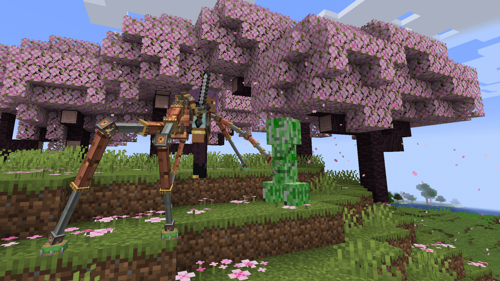

**Contents:** [Walk](#walk-four-tentacles) · [Work](#work-two-actuators) · [Controls](#controls) · [On screen](#on-screen) · [Crafting](#crafting-and-fitting) · [Air, tiers, enchantments](#air-tiers-and-enchantments) · [Ships](#ships-sable--create-aeronautics) · [Compatibility](#compatibility) · [Install](#requirements) · [Config](#config) · [Limits](#known-limitations) · [FAQ](#faq)

## In short

| | What | How |
|---|---|---|
| **Walk** | A **Tentacle Rig** carries you where you look: over the floor, up a wall, under a ceiling. Your hands stay free. | Wear it, **Double Jump** |
| **Work** | Two **Actuators** make it an **Octo Rig**. Each one is a hand: it carries that hand's item and does what the hand does, out to the Rig's **Reach**. A free one **Grabs** a mob. | Fit them at a crafting table, then just play. Grab is `V` |
| **Power** | The Rig runs on the Backtank's **Air**. | Place it under a spinning shaft to refill |

The only required dependency is Create. The terms used here are explained in the [glossary](docs/CONTEXT.md).

## Walk: four Tentacles

- **Double Jump** to activate, also in mid-air. The Rig catches you as soon as a Grip is in Reach, with no fall damage.
- **Move where you look.** Forward follows the camera, `Space` goes up, `Shift` goes down. Walk into a wall to climb it, walk under a ledge to hang.
- **Grips** are solid block surfaces: floors, walls, ceilings, slabs and stairs at their real height, also underwater. Nothing narrower than half a block.
- **You can't walk off an edge.** The Rig only moves you where at least two Tentacles can hold.
- **Hang** as long as you like. Holding still uses very little Air.
- **Double Jump again** and the Rig **Sets you Down** on the floor and folds up.
- **Out of Air** the Rig does not drop you. It **Crawls** you down to the nearest floor, then folds up.
- **Hands free.** Mining, placing, fighting and using items all work while the Rig carries you.
- Everyone on the server sees the stepping gait and hears the Stickers and pistons.

| Climbing a wall | Hanging under a bridge |
|---|---|
| 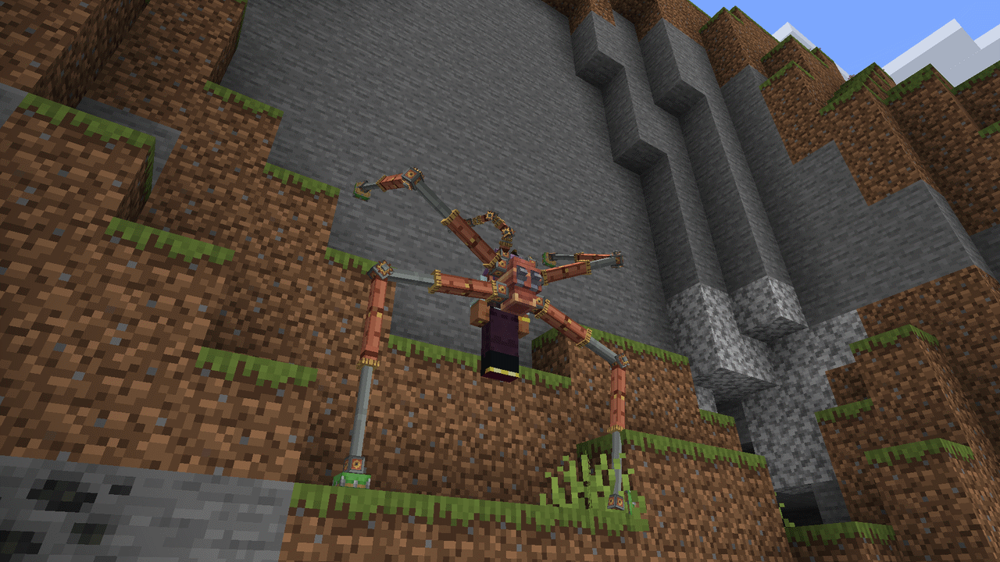 |  |

If the blocks under your Grips are broken and no new Grip is in Reach, you fall with normal fall damage until the Rig finds a Grip again.

## Work: two Actuators

New in 2.0. Two Actuators sit above the Tentacles, one for each hand. The main-hand Actuator carries your main-hand item, the off-hand Actuator the off-hand item. They work wherever your hands work: Rig out or folded, on a Ride, gliding, falling. Fitting is optional: a Rig without Actuators is a complete Rig that only walks.

### Far Use

Whatever a hand does, its Actuator does farther: mine, place, hit and use, on blocks, mobs and players, out to the Rig's Reach (Copper 5 blocks, Netherite 7). Never through a wall. Drops and XP of a block mined this way fly to you.

### Dual Wield

Put a tool in each hand and both Actuators work at once. Two pickaxes mine at the sum of their speeds, two axes fell a tree twice as fast, an off-hand sword adds its damage to your hit.

| Far Use | Dual Wield |
|---|---|
| 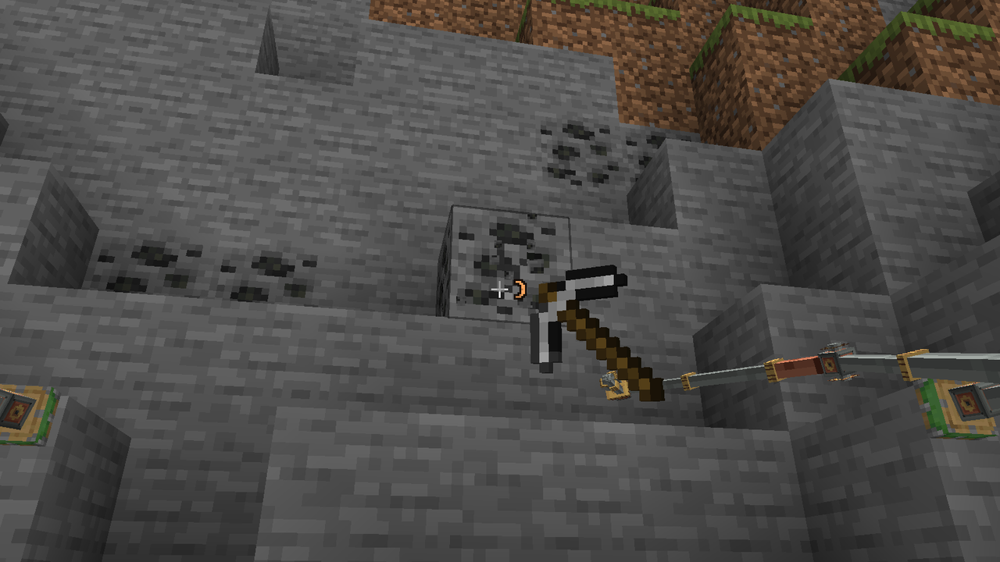 | 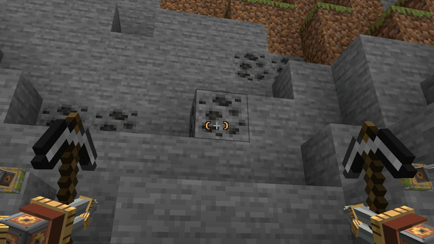 |

### Grab, Set Down, Throw

- **Grab** (`V`): look at a mob in Reach. An Actuator with an empty hand takes it and holds it at your side. The mob is **Pinned**: no attacks, no Creeper fuse. Your other hand keeps working.
- **Set Down**: tap `V` and the mob is put where you look. An outline shows the spot. Hold `V` and turn the mouse wheel to move it nearer or farther.
- **Throw**: attack while holding. The mob flies along your view and takes **Impact** damage when it hits a block or another mob.
- Big mobs (Iron Golem, Ravager, Horse, Enderman, Ghast) take both Actuators and both empty hands. Players and bosses can't be Grabbed.

| Grab | Set Down |
|---|---|
| 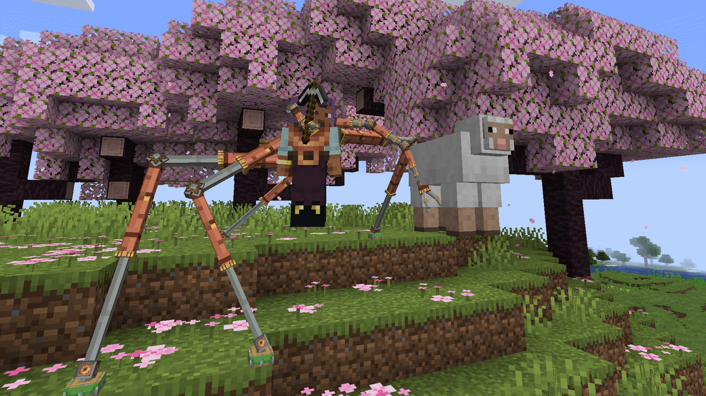 | 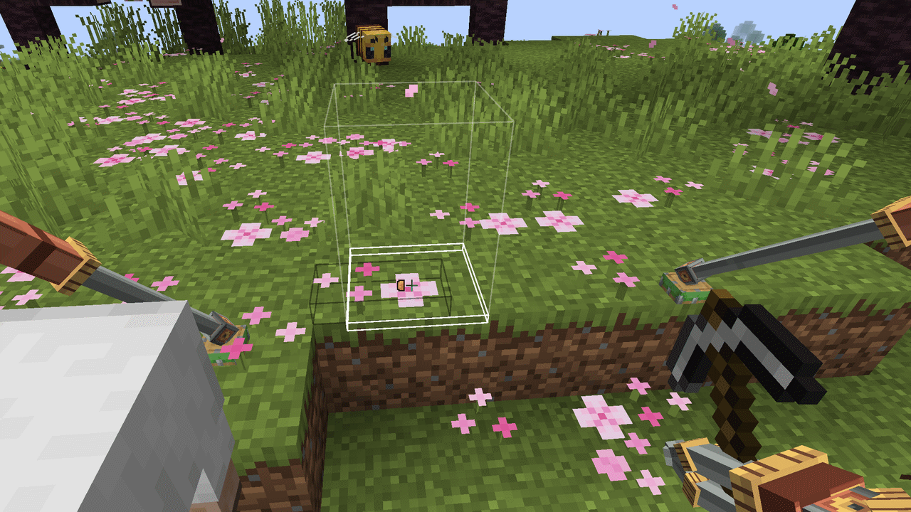 |

| Throw | Ship Grab (1.21.1 with Sable) |
|---|---|
| 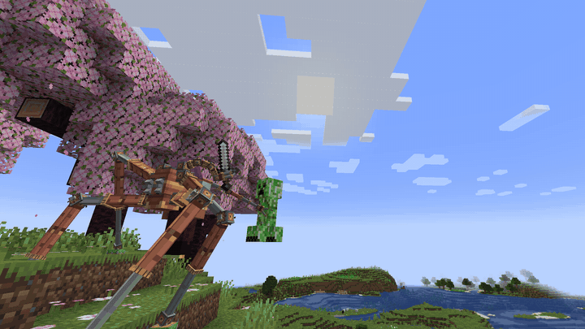 | 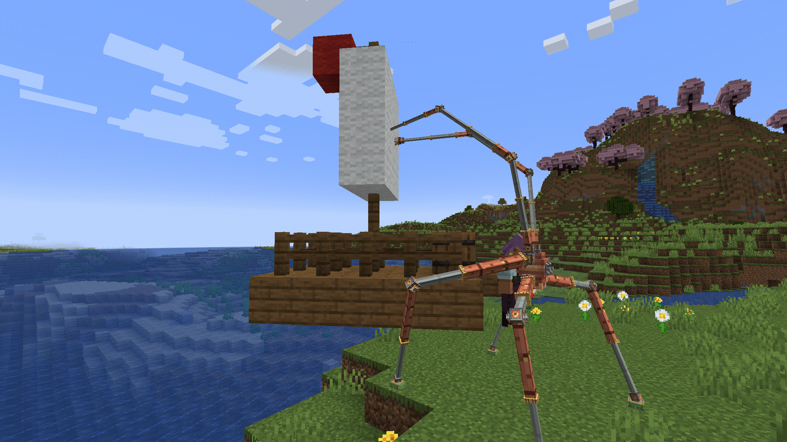 |

<details>
<summary><b>All Actuator rules</b></summary>

**Far Use**

- Reach is measured from the Rig body, like a Tentacle's Grip. Far Reach adds to it.
- Past arm's length the server checks the target is in sight of your eye: nothing is reached through a wall, a pane or the floor.
- Only an action past arm's length that does something costs Air: a lever flipped, a block placed, a mob hurt, a block that starts to break.
- With an Extendo Grip in hand the Rig adds no reach. Far Use leaves Ship blocks to your own reach.
- Rig Settings row **Far Use**: Always (default), Rig out only, or Off.

**Dual Wield**

- Needs both Actuators free. Mining: both tools must suit the block; each uses its own Efficiency and both wear. An off-hand tool alone does the work, gets its drops and takes the wear. Fortune and Silk Touch stay the main hand's.
- Melee: the off-hand weapon or tool adds its damage and damage enchantments, scaled by your attack strength, and wears.
- Item use is not sped up. Not while the off-hand Actuator holds a mob, during a heavy hold, or without Air. Server config `actuators.dualWield` turns it off.

**Grab**

- The off-hand Actuator takes the mob if your off hand is empty, else the main-hand one if your main hand is empty. An item that lands in the holding Actuator's hand sets the mob down.
- You can shear, milk, name, saddle or leash a held mob.
- Light mobs (up to 1.5 blocks wide and 2 tall: zombie, villager, cow, spider) take one Actuator. Heavy ones take both: Far Use pauses and you move at 60% speed.
- Never: players, bosses (Ender Dragon, Wither, Warden, anything over 100 max health, the `tentaworks:bosses` entity tag), anything riding or ridden, anything another wearer holds or another player has on a lead, or another player's pet unless the server allows it. Claim and protection mods are asked first. A refused Grab says why on the action bar.
- The hold lasts through Stowing, Setting Down, Rides, gliding and Falling. It ends on Crawl, death, logout, taking the Rig off, a dimension change, the target gone or out of Reach, or no Air left: the target is set down where it is.

**Set Down and Throw**

- The spot is on top of the block under the crosshair, or beside its side and down to the floor. The outline is red when the mob does not fit, or the spot is out of Reach or out of sight; then it is set down where it hangs. Looking at a seat, boat or minecart puts it in. A mob that was set down stays calm for one second.
- With an item in the main hand a plain attack uses the item, so hold `V` and attack to Throw. Netherite throws faster.
- A thrown mob takes fall damage and Impact damage, and what it hits is hurt too. Impact counts as your damage (loot, XP, protection rules) and hurts players only where PvP allows.

**Ship Grab** (1.21.1 with Sable)

- `V` on a block of a Ship, with both hands empty, takes the whole Ship in both Actuators. It follows your view; `V` with the wheel moves it nearer or farther, a tap of `V` lets it go, attack throws it.
- Needs a Ship of scale 1 within the tier's mass cap (Copper 2000, Netherite 6000 Sable mass), nobody else on board, and not the Ship you stand on or hang from. Server config `grab.ships` turns it off.

**Look**

- At rest the Actuators curl up above your head. In first person they enter from the edge of the view and stand in for both hands.
- Client config `firstPerson.limbOpacity` draws every Limb (Tentacles and Actuators) in first person from solid (1.0) down to faint (0.1).

</details>

## Controls

| Input | When | What it does |
|---|---|---|
| **Double Jump** (jump twice quickly) | Rig worn | Activates the Rig. Again: Sets you Down |
| `W` `A` `S` `D` | Rig out | Move where you look |
| `Space` / `Shift` | Rig out | Up / down. `Shift` also sneaks, without the crouch |
| Attack, Use | Octo Rig | The hand's Actuator does it, out to Reach (Far Use) |
| `V` (**Grab**) | Looking at a mob in Reach, a hand empty | Grab it |
| Tap `V` | Holding | Set Down where you look |
| Hold `V` + mouse wheel | Holding | Move it nearer or farther |
| Attack | Holding | Throw. With an item in the main hand: hold `V` + attack |
| Sneak + Use the Rig item, not aimed at a block | Rig in hand | Opens the **Rig Settings** |
| Use the Rig item on a block | Rig in hand | Places it as a **Rig Block** |
| Use with an empty hand | On a Rig Block | Picks it up, with its Air and settings |
| Hold `W` | Mouse over a Rig or Tentacle in the inventory | Ponder |

Key binds (Controls > Octo Arms): **Grab (Actuators)** is `V`. **Rig Settings (worn Rig)** and **Toggle Tentacle Rig (key-only mode)** are unbound by default. With Curios installed its own key stays on `G`.

**Rig Settings**: Standing Height (0 to Reach, default 1.5 blocks), Speed, Activation Mode (Double Jump or key only) and, on an Octo Rig, Far Use.

**Creative mode**: a worn Rig uses no Air. The Double Jump goes to the Rig; press jump a third time while it is out, or use the fly key, for creative flight.

## On screen

In first person the crosshair shows what the Actuators will do before you click. No words at the crosshair. Each bracket is one Actuator: the left bracket is the left one.

| Mark | Meaning |
|---|---|
| 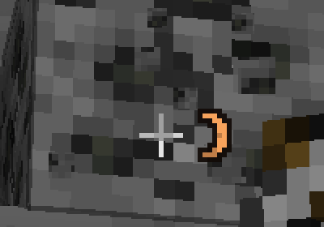 | This Actuator reaches what you look at |
| 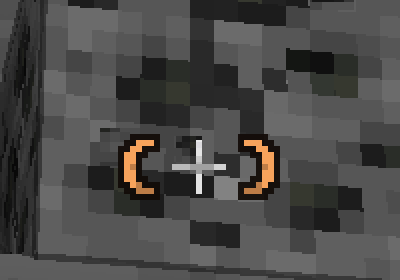 | Both work together: Dual Wield |
| 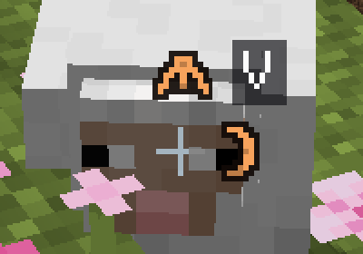 | Open claw: a free Actuator can Grab this mob. The key hint shows for the first two holds of a session |
| 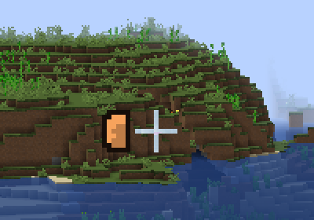 | Shut bracket: this Actuator holds something |
| 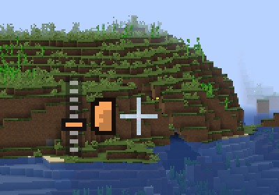 | With `V` down: the hold distance, changed with the mouse wheel |

Also: a hollow pair when the target is just out of Reach, red marks when the Actuators have no Air, a glyph above the crosshair when a Grab is not possible (press `V` anyway and the action bar says why). A small line by the hotbar names what you hold. All of it hides with F1 and in third person. Client config `hud.crosshair` and `hud.hints` turn the marks and the key hints off.

## Crafting and Fitting

| Item | What it is | How to get it |
|---|---|---|
| **Tentacle** | One walking arm. Four go into every Rig | Sequenced Assembly on a Piston Extension Pole: deploy Sticker, press, deploy Andesite Casing, 2 loops |
| **Copper Tentacle Rig** | Reach 5, 112 durability | Mechanical Crafting with a Copper Backtank |
| **Netherite Tentacle Rig** | Reach 7, half the Air use, 592 durability, fire resistant | Mechanical Crafting with a Netherite Backtank, or Smithing: Copper Rig + Netherite Upgrade + Netherite Ingot (keeps Air and Actuators) |
| **Actuator** | One working arm. Two fit on a Rig | Sequenced Assembly on a Piston Extension Pole: deploy Brass Casing, press, deploy Sticker, 2 loops |
| **Copper / Netherite Octo Rig** | A Rig with two Actuators. Same item, new name; the tooltip says "Actuators fitted" | **Fitting**: Actuator, Rig, Actuator in one row of a crafting table |
| **Rig Block** | A Rig placed in the world. Refills under a spinning shaft | Use a Rig on a block |

Mechanical Crafting pattern for a Rig (3×3): Tentacles in the four corners, Precision Mechanism top centre, Brass Casing left and right, the Backtank in the centre, a Copper Sheet bottom centre. Add an Actuator at each end of the middle row to build an Octo Rig in one go.

Fitting keeps the Rig's Air, enchantments, Rig Settings and damage. It is permanent. A new Rig starts with **no Air**: Mechanical Crafting does not copy the Backtank's Air.

| Tentacle | Actuator |
|---|---|
|  | 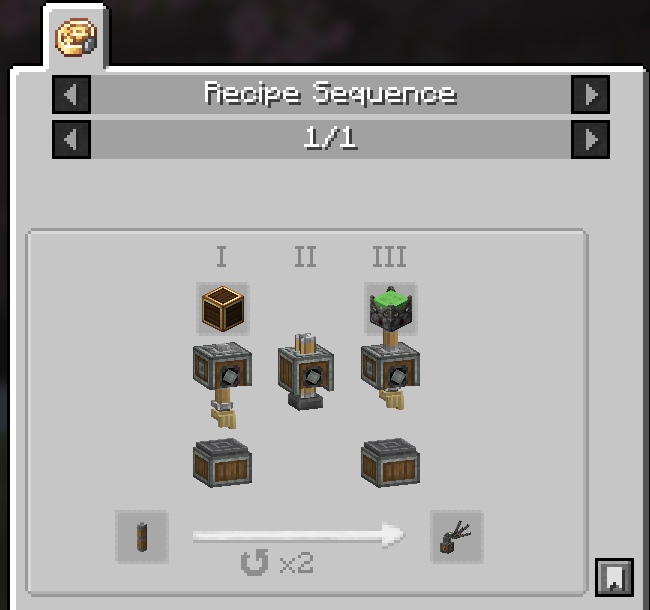 |

| Rig and Octo Rig on Mechanical Crafters | Fitting at a crafting table |
|---|---|
| 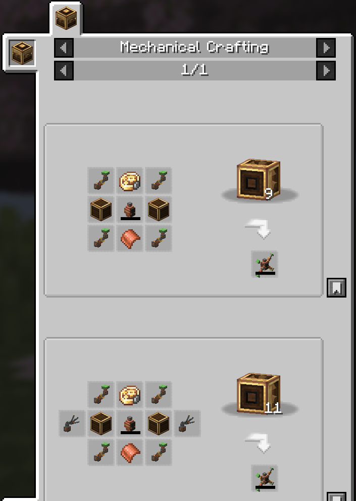 | 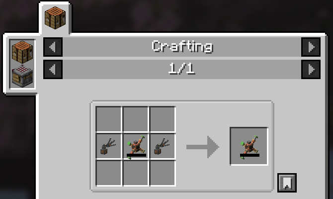<br><br>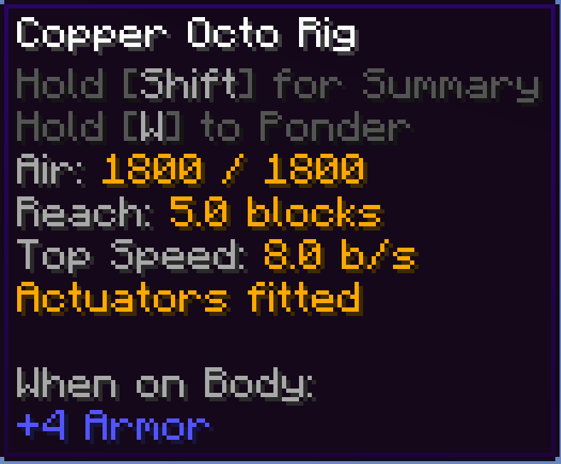 |

<details>
<summary><b>Item tooltips</b></summary>


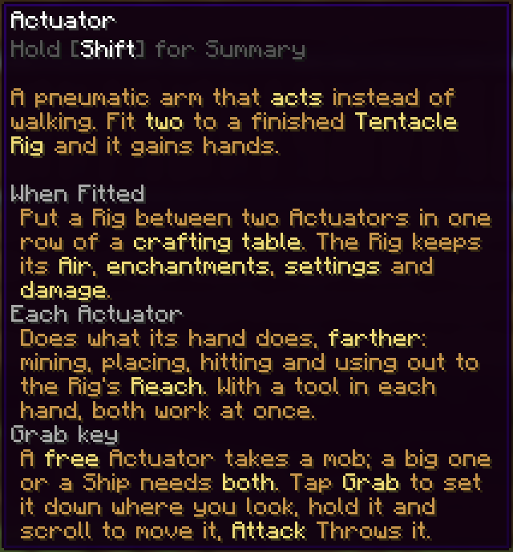

</details>

## Air, tiers and enchantments

A Rig holds twice the Air of the Backtank it was made from: 1800, more with Capacity. To refill, place it as a Rig Block under a spinning shaft. It still feeds a Diving Helmet.

| Air use, Copper Rig | Amount |
|---|---|
| Holding still or hanging | 1 Air per 4 s |
| Moving | 1 Air per second |
| Climbing | 2 Air per second |
| Far Use or Dual Wield action | 0.5 Air each |
| Holding a Grab | 1 Air per 2 s |
| Throw | 10 Air |

A Netherite Rig uses half. Without Air the Rig Crawls you down, the Actuators hang limp and let go.

| Tier | Reach | Air use | Durability | Extra |
|---|---|---|---|---|
| Copper | 5 blocks | normal | 112 | |
| Netherite | 7 blocks | half | 592 | Fire resistant, faster Throws, lifts heavier Ships |

A Rig never breaks. Like an Elytra it stops working at 1 durability until you repair it at an anvil (Copper Ingot or Netherite Ingot) or with Mending.

| Enchantment | Levels | Effect |
|---|---|---|
| **Far Reach** | I–III | +1 block of Reach per level |
| **Thrift** | I–III | −15 % Air use per level |
| **Swift** | I–II | +15 % Speed per level |
| **Silent Step** | I | With the Rig out, Sculk Sensors, Shriekers and Wardens do not hear you, and the Rig makes no sound |
| **Deft** | I | The Actuators use no Air |

Also Protection (all kinds), Unbreaking, Mending, Thorns and Create's Capacity.

## Ships (Sable / Create Aeronautics)

With Sable installed (1.21.1 only), blocks of a Ship are Grips like world blocks. Create Aeronautics is not needed, but its Ships are Sable Ships, so they work too. Without Sable nothing changes.

- Grip a Ship's floor, walls, hull or underside, parked or moving. A Held wearer is carried with the Ship, also around its turns.
- Move freely between world blocks and a Ship, both ways. Air use counts only your own move.
- With Actuators fitted, [Ship Grab](#grab-set-down-throw) lifts a whole Ship.
- Server admins can turn it off: `ships.grip = false`, and `grab.ships = false` for Ship Grab.

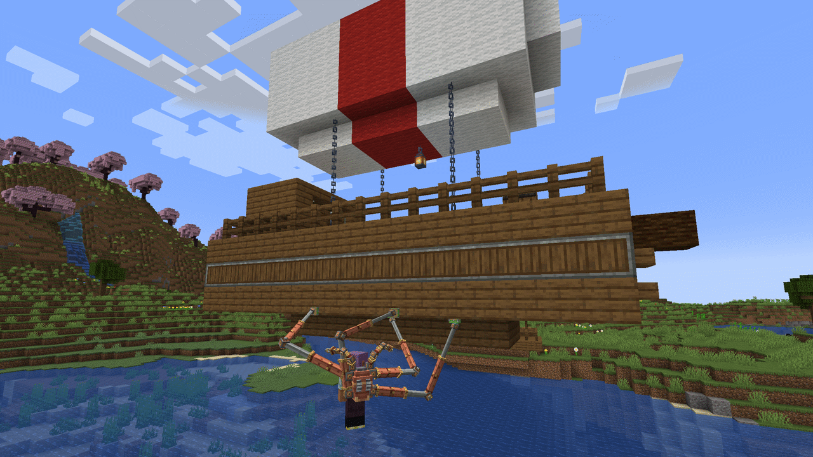

Limits: Ships with a scale other than 1 are ignored. Other players on a fast Ship are drawn about 1.5 ticks behind it. When a Ship speeds up or slows down, the Rig may use a little extra Air. Tested over localhost only, with Ships moving at up to 15 blocks/s and turning at 20°/s.

## Compatibility

| Mod | What works |
|---|---|
| **Ponder** (comes with Create) | One scene, "Tentacle Rig": crafting, refilling, Double Jump, walking, climbing, hanging, Setting Down and Crawl |
| **Engineer's Goggles** | On a Rig Block: Air, the fill rate (or "needs a turning shaft above"), Reach, Top Speed, and Air use when it is not 100 % |
| **Create Display Link** | A Rig Block is a "Rig Air" source (number, percent or progress bar) for Display Boards and Nixie Tubes |
| **JEI** (optional) | All recipes: Sequenced Assembly, Mechanical Crafting, Smithing and, for Fitting, Crafting |
| **Sable / Create Aeronautics** (optional) | Grip, ride and Grab Ships. See [Ships](#ships-sable--create-aeronautics) |
| **Curios** (optional) | The Rig fits the back slot, so a chestplate stays on |
| **Claim and protection mods** | A Grab asks the loader's entity-interaction event first. Far Use goes through the vanilla block and entity events |

Tested together with Elytra Slot, Sophisticated Backpacks and Carry On. Jade: no special support.

| Engineer's Goggles on a Rig Block | Ponder |
|---|---|
| 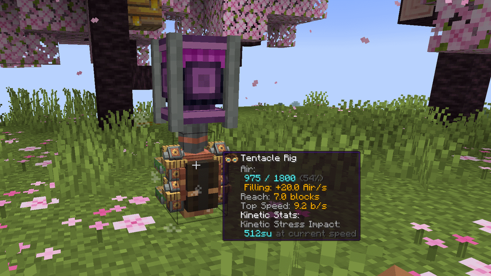 |  |

<details>
<summary><b>Curios back slot rules</b></summary>

With Curios (1.21.1: 9.2.0 or newer; 1.20.1: 5.3.0 or newer) both Rigs fit the `back` slot. A Rig there is a Rig, not armor:

- Works: Air (also for a Diving Helmet), Reach, the Actuators, all five Rig enchantments, Capacity, Rig Settings, Mending, repair at an anvil. Hits wear it like chest armor.
- Does nothing: armor value, armor toughness, knockback resistance, Protection and its kinds, Thorns. The tooltip says so.
- One Rig at a time. With a Rig in both slots, the chest Rig wins and the other does nothing (red tooltip).
- Using a Rig from the hand: empty chest slot, it is worn as armor; a chestplate on and a free back slot, it goes to the back slot.
- Elytra in the chest slot and the Rig in the back slot: the Elytra never opens while the Rig is out. Set Down, then jump and glide.
- Server config `curios.backSlot = false` turns the back slot off for Rigs.

</details>

## Requirements

| Mod | Version (1.21.1 build) |
|---|---|
| Minecraft | 1.21.1 |
| NeoForge | 21.1.228 or newer |
| Create | 6.0.4 or newer, below 6.1.0 |
| Sable | optional, 2.0.0 or newer, below 2.1 (for Ships) |
| Curios | optional, 9.2.0 or newer, below 10 (Rig in the back slot) |
| JEI | optional |

Built and tested with NeoForge 21.1.250 and Create 6.0.10; Ships with Sable 2.0.6 and Create Aeronautics 1.3.2; the back slot with Curios 9.5.1.

## Downloads

Two builds share one version number and the same gameplay. Ships (Sable), Ship Grab included, are 1.21.1 only.

| Minecraft | Loader | Jar | Branch |
|---|---|---|---|
| 1.21.1 | NeoForge 21.1 | `octo-arms-<version>+mc1.21.1.jar` | [`1.21.1`](https://github.com/SenDeliver/create-octo-arms/tree/1.21.1) |
| 1.20.1 | Forge 47 | `octo-arms-<version>+mc1.20.1.jar` | [`1.20.1`](https://github.com/SenDeliver/create-octo-arms/tree/1.20.1) |

- [CurseForge](https://www.curseforge.com/minecraft/mc-mods/create-octo-arms)
- [GitHub Releases](https://github.com/SenDeliver/create-octo-arms/releases)
- Modrinth: not listed yet.

## Install

1. Install NeoForge and Create.
2. Drop the `octo-arms-<version>+mc1.21.1.jar` file into your `mods/` folder.
3. Install it on **both** the client and the server, same Octo Arms version on both: a 1.8 client cannot join a 2.0 server.
4. Optional: Sable on both sides for Ships, Curios on both sides for the back slot.

The server does not need `allow-flight=true`.

### Upgrading from 1.x to 2.0

- Nothing breaks: your world and your Rigs keep working. Still, make a backup first.
- Update the server and every client together.
- An old Rig stays as it is. To get the new arms, craft it with two **Actuators**: it becomes an Octo Rig and keeps everything.
- Grab is on `V`. Make sure no other mod uses that key.

Everything that changed is in the [changelog](CHANGELOG.md).

## Config

Server config: `serverconfig/tentaworks-server.toml` inside the world folder (put a copy in `defaultconfigs/` to use it for new worlds). Client config: `config/tentaworks-client.toml`, or in game under Mods > Octo Arms > Config.

<details>
<summary><b>Server config keys</b></summary>

| Section | Key | Default | What it does |
|---|---|---|---|
| `reach` | `copper` | 5.0 | Reach of a Copper Rig, blocks (1–16). Far Reach adds to it, up to 16 in total |
| `reach` | `netherite` | 7.0 | Reach of a Netherite Rig, blocks (1–16) |
| `speed` | `max` | 8.0 | Top Rig speed, blocks per second (1–20). Caps every player's Speed setting; Swift raises both |
| `air` | `capacityFactor` | 2.0 | Max Air of a Rig relative to a Backtank of the same Capacity (1–8) |
| `air` | `idle` | 80.0 | Copper Rig holding still (Idle, Hang): ticks per 1 Air |
| `air` | `move` | 20.0 | Copper Rig moving level or down: ticks per 1 Air |
| `air` | `climb` | 10.0 | Copper Rig climbing: ticks per 1 Air |
| `air` | `farUse` | 0.5 | Copper Rig: Air per Far Use action (0–50) |
| `air` | `dualWield` | 0.5 | Copper Rig: Air per Dual Wield action, a block broken or a hit the off-hand item helped with (0–50) |
| `air` | `grab` | 40.0 | Copper Rig holding a Grab: ticks per 1 Air |
| `air` | `throw` | 10.0 | Copper Rig: Air per Throw (0–500) |
| `air` | `netheriteFactor` | 0.5 | Air use of a Netherite Rig relative to Copper (0–4) |
| `crawl` | `speed` | 1.0 | Descent speed with no Air left (Crawl), blocks per second |
| `enchant` | `farReachPerLevel` | 1.0 | Far Reach: extra Reach per level, blocks |
| `enchant` | `thriftPerLevel` | 0.15 | Thrift: Air use cut per level (0.15 = −15 %, max 0.3) |
| `enchant` | `swiftPerLevel` | 0.15 | Swift: extra Speed per level (0.15 = +15 %) |
| `farUse` | `players` | true | Far Use may hit and use on players (the PvP rule still applies) |
| `actuators` | `dualWield` | true | Dual Wield on or off |
| `grab` | `tamedOthers` | false | Grab may take another player's tamed, owned or leashed animal |
| `grab` | `heavySpeedFactor` | 0.6 | Walking and Rig Speed while both Actuators hold a heavy target, relative to normal |
| `grab.throwSpeed` | `copper` | 0.8 | Throw speed of a Copper Rig, blocks per tick (0.1–5) |
| `grab.throwSpeed` | `netherite` | 1.2 | Throw speed of a Netherite Rig, blocks per tick (0.1–5) |
| `impact` | `damagePerSpeed` | 12.0 | Impact damage per block per tick of speed above `minSpeed`, dealt once per Throw |
| `impact` | `minSpeed` | 0.3 | Slowest Thrown speed that deals Impact damage, blocks per tick |
| `impact` | `cap` | 20.0 | Most Impact damage one Throw can deal |
| `ships` | `grip` | true | Rigs grip Sable Ships. No effect without Sable |
| `grab` | `ships` | true | Ship Grab (1.21.1). Also needs `ships.grip`. No effect without Sable |
| `grab.massCap` | `copper` | 2000.0 | Heaviest Ship a Copper Rig can Grab, Sable mass |
| `grab.massCap` | `netherite` | 6000.0 | Heaviest Ship a Netherite Rig can Grab, Sable mass |
| `curios` | `backSlot` | true | A Rig in the Curios back slot works but is not armor. Off: the back slot refuses Rigs. No effect without Curios |

</details>

<details>
<summary><b>Client config keys</b></summary>

| Section | Key | Default | What it does |
|---|---|---|---|
| `animation` | `walkWhileHeld` | false | Vanilla walk animation while the Rig or a Ship carries you. Off: the body hangs still |
| `movement` | `forward` | look | What `W`/`S` follow while the Rig carries you. `look`: the camera. `flat`: level only; `Space`/`Shift` change the height |
| `firstPerson` | `limbOpacity` | 1.0 | How solid every Limb (Tentacles and Actuators) is drawn in first person: 1.0 solid, down to 0.1 faint |
| `hud` | `crosshair` | true | Actuator marks and Grab cues around the crosshair |
| `hud` | `hints` | true | Key hints for the first two holds of a game session |

</details>

<details>
<summary><b>Advancements</b></summary>

All under Create's Backtank advancement.

| Advancement | How |
|---|---|
| **Doc's Rig** | Get your first Rig |
| **Fitted** | Fit two Actuators to a Rig |
| **Hang In There** | Hang under a ceiling for a whole minute |
| **Spider, Man** | Kill a spider with the Rig out |
| **Intelligence Is a Privilege** | Put Far Reach, Thrift, Swift, Silent Step and Deft on one Rig |
| **The Power of the Sun** | Grab a Blaze |
| **Special Delivery** | Throw a mob so it lands 20 blocks or more away |
| **Fridge Mover** | Grab a Ship and set it down 50 blocks from where you took it (1.21.1 with Sable only) |

</details>

## Known limitations

- **Narrow blocks**: nothing narrower than half a block (fence posts, chains, rail sides) and nothing with a hole under the tip (hopper and cauldron rims, scaffolding sides) is a Grip.
- **Actuators**: a placed Rig Block does not show them. The Ponder scene does not cover them yet.
- **New Rigs start empty**: Mechanical Crafting does not copy the Backtank's Air. Smithing Copper to Netherite keeps it.
- **Client-driven movement**: the wearer's client moves the player; the server checks Grips, Reach, Air use, speed and direction. Not tested with server anti-cheat plugins.
- **Network tests**: tested with up to two players over localhost. Real latency and many players at once are not tested yet.
- **Ships**: see the limits under [Ships](#ships-sable--create-aeronautics).
- The player preview in the creative inventory always shows the Rig folded.
- Limb parts are lit by the light at their centre, so a part crossing a dark block edge can look one shade off.

## FAQ

**Do my old Rigs still work?**
Yes. A Rig from before 2.0 walks as before and can be fitted with Actuators at any time. Nothing on it is lost.

**Does it need Create Aeronautics or Sable?**
No. Octo Arms depends only on Create. With Sable the Rig also grips, rides and Grabs Ships.

**Is the Rig still a Backtank?**
Yes. It holds Backtank Air, feeds a Diving Helmet underwater, takes Capacity, and refills under a spinning shaft when placed. Placing it is the only way to refill it.

**Can the Tentacles attack mobs or push blocks?**
No. Tentacles only hold on. Working is the Actuators' job: fit two and they mine, place, hit, Grab and Throw.

**Can I Grab another player, or a boss?**
No. Players and bosses are never Grabbed. Another player's pet only if the server allows it.

**What happens when the Rig runs out of durability?**
It never breaks. At 1 durability it can't be activated until you repair it.

**Why is the mod id `tentaworks`?**
That was the working name. The id stays so worlds keep their Rigs, Rig Blocks, enchantments and settings. Don't rename it in forks if you want save compatibility.

## Building from source

Needs JDK 21 or newer (Gradle uses a Java 21 toolchain).

```sh
./gradlew build        # jar in build/libs/
./gradlew runClient    # dev client
./gradlew runClient -PwithSable   # dev client with Sable + Aeronautics
./gradlew runServer    # dev server
./gradlew runData      # regenerates src/generated
```

## Contributing

Bug reports, ideas and pull requests are welcome. See [CONTRIBUTING.md](CONTRIBUTING.md) and the [Code of Conduct](CODE_OF_CONDUCT.md). Design notes are in [docs/](docs/): [glossary](docs/CONTEXT.md), [design](docs/design.html), [decisions](docs/adr/), [save format](docs/save-format.md), [development notes](docs/phase-notes.html).

Branches: `1.21.1` is the NeoForge 1.21.1 build, `1.20.1` the Forge 1.20.1 build, `main` is frozen at 1.5.0. Pull requests go to the branch of the version they change.

## License and credits

Create: Octo Arms is released under the [MIT License](LICENSE). Copyright (c) 2026 SenDeliver.

Built on top of, but **not bundling**, [Create](https://github.com/Creators-of-Create/Create) by the Create team (MIT). It uses Create's Backtank, Sticker and Ponder.

Developed with AI assistance (Claude).
