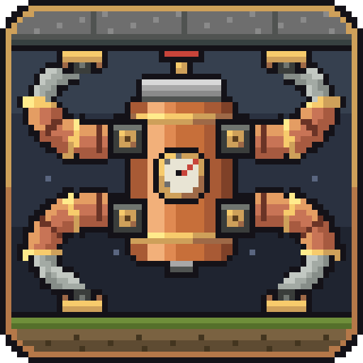
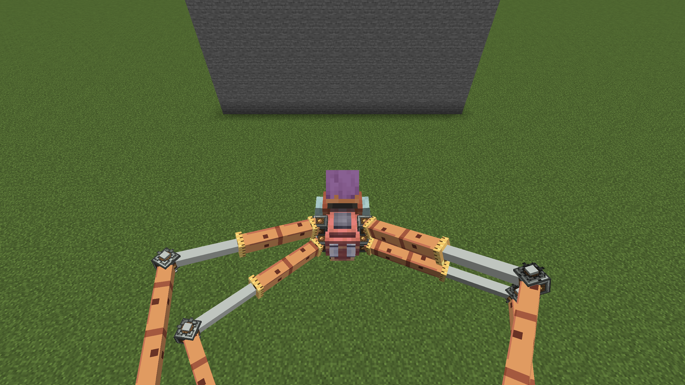
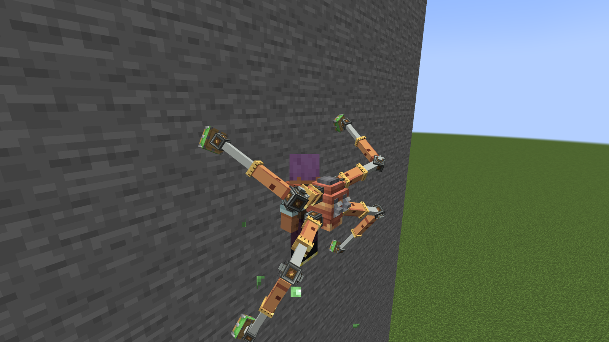
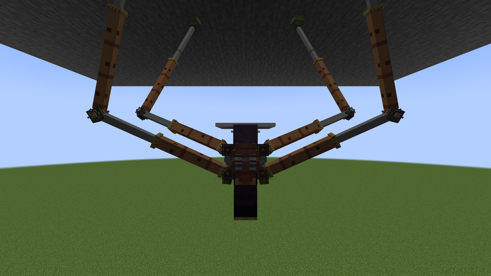
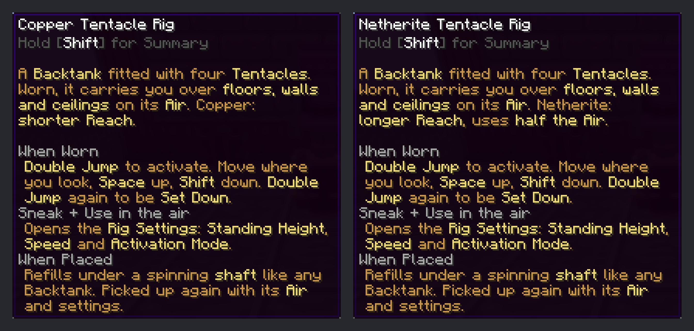
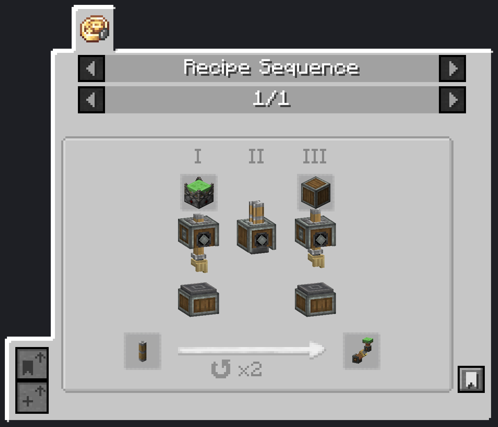
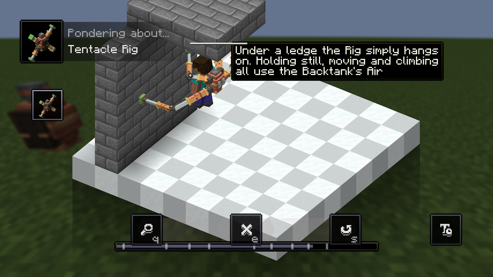
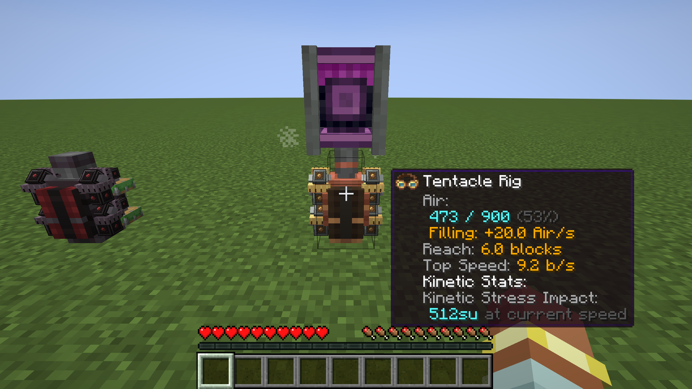
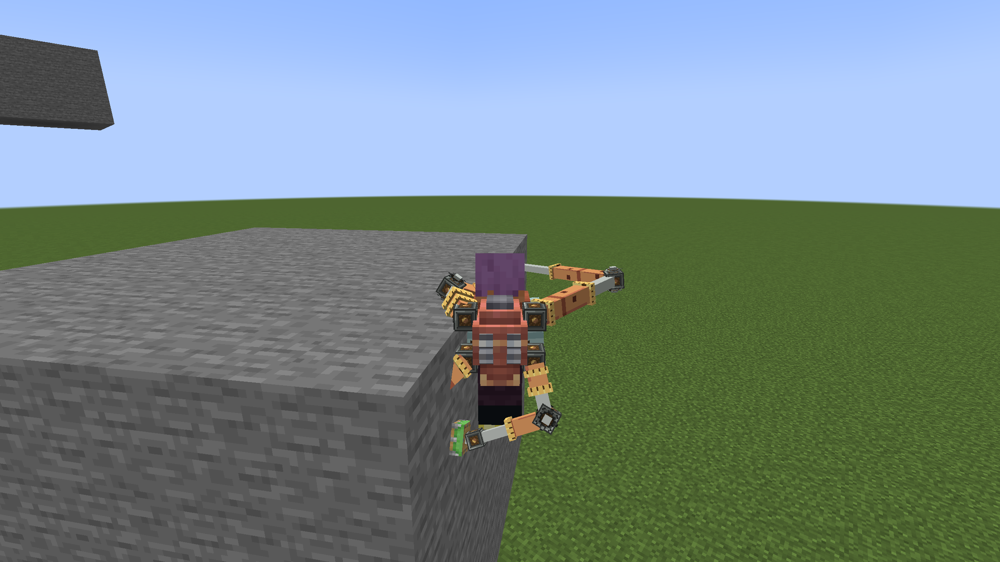
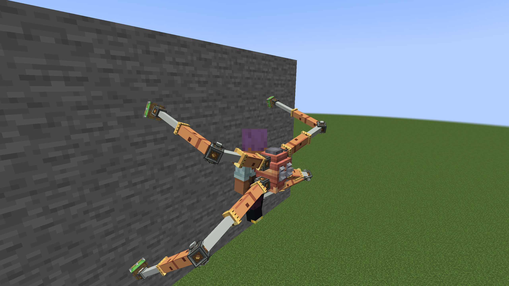

<p align="center">
  
</p>

# Create: Octo Arms

Fit four pneumatic Tentacles to a Create Backtank and let them carry you over floors, walls and ceilings. Doc Ock style.

[](LICENSE)
[](https://www.minecraft.net/)
[](https://neoforged.net/)
[](https://github.com/Creators-of-Create/Create)



## What it does

Craft a **Tentacle Rig**: a Backtank with four **Tentacles** and a Precision Mechanism. Wear it in the chest slot and **Double Jump**. The Tentacles grab nearby block faces and carry you where you look: across the floor, up a wall, under a ledge or a ceiling. Your hands stay free, so you can mine, build and fight while you hang.

The Rig runs on the Backtank's **Air**. Holding still uses a trickle, moving uses more, climbing the most. Place the Rig as a block under a spinning shaft to refill it, like any Backtank. Double Jump again and the Rig **Sets you Down** on the floor.

The only required dependency is Create. With Sable (optional) the Rig also grips and rides Ships. The terms used here (Tentacle Rig, Grip, Reach, Air, Crawl, ...) are explained in the [glossary](docs/CONTEXT.md).

## Features

- **Climb anything solid**: Tentacles grip any full block face: floor, wall, ceiling, the underside of a ledge, also underwater.
- **Ride Ships**: with Sable (or Create Aeronautics) installed, Tentacles grip Ship blocks too and the Rig carries you along with a moving, turning Ship. See [Ships](#ships-sable--create-aeronautics).
- **Move where you look**: forward follows the camera (also up and down), `Space` goes up, `Shift` goes down. You can't walk off an edge: the Rig only moves you where at least two Tentacles can hold.
- **Hang** under ledges and ceilings, as long as you like.
- **Double Jump** to activate, also in mid-air: the Rig catches you as soon as a Grip is in Reach, with no fall damage.
- **Setting Down**: Double Jump again and the Rig lowers you to the floor and folds up. With no floor in Reach, it lets go at the lowest point it can hold.
- **Crawl**: out of Air, the Rig does not drop you. It slowly lowers you to the nearest floor, then folds up.
- **Hands free**: mining, placing, fighting and using items all work while the Rig carries you. `Shift` also sneaks, so sneak + right click works, without the crouch.
- **Still a Backtank**: it holds Air, feeds a Diving Helmet, takes Capacity and refills under a shaft.
- **Two tiers**: Copper (Reach 4) and Netherite (Reach 7, half the Air use, fire resistant).
- **Three own enchantments**: Far Reach, Thrift and Swift, plus vanilla chest armor enchantments and Create's Capacity.
- **Never breaks**: like an Elytra, a worn-out Rig stops working at 1 durability until you repair it. Air, enchantments and settings are kept.
- **Rig Settings** screen: Standing Height, Speed and Activation Mode (Double Jump or a key).
- A stepping gait everyone on the server sees, with Sticker and piston sounds.
- Create-style tooltips, a Ponder scene, Engineer's Goggles info, a Display Link source and JEI recipes.

| Climbing a wall | Hanging under a ceiling |
|---|---|
|  |  |

## Items and blocks

| Item / block | What it is | How to get it |
|---|---|---|
| **Tentacle** | One pneumatic arm. Four go into every Rig. Tier-less. | Sequenced Assembly on a Piston Extension Pole: deploy Sticker, press, deploy Andesite Casing, 2 loops |
| **Incomplete Tentacle** | Transitional item of the Tentacle sequence | — |
| **Copper Tentacle Rig** | Worn Rig, Reach 4 blocks, normal Air use, 112 durability | Mechanical Crafting (see below) with a Copper Backtank |
| **Netherite Tentacle Rig** | Worn Rig, Reach 7 blocks, half the Air use, 592 durability, fire resistant | Mechanical Crafting with a Netherite Backtank, or Smithing: Copper Tentacle Rig + Netherite Upgrade + Netherite Ingot (keeps Air) |
| **Rig Block** (Copper / Netherite) | A Rig placed in the world. Refills under a spinning shaft, like a Backtank. Not a separate item: place the Rig, pick it up again. | Use a Rig on a block |

Mechanical Crafting pattern for both Rigs (3×3): Tentacles in the four corners, Precision Mechanism top centre, Brass Casing left and right, the Backtank in the centre, a Copper Sheet bottom centre. Check JEI for the exact recipes.

Getting your first Rig unlocks the advancement **Doc's Rig** (after Create's Backtank advancement).

| Tooltips | Sequenced Assembly in JEI |
|---|---|
|  |  |

## How to use

1. **Craft Tentacles** on a Sequenced Assembly line, then the **Rig** on Mechanical Crafters. A new Rig starts with **no Air**.
2. **Fill it**: use the Rig on a block to place it (Rig Block), put a spinning shaft above it and wait. Use it with an empty hand to pick it up again; Air, enchantments and settings stay on the item.
3. **Wear it** in the chest slot (it replaces your chestplate, like a Backtank).
4. **Double Jump** (press jump twice quickly) to activate. The Rig lifts you to your Standing Height.
5. **Move**: look where you want to go and walk. `Space` = up, `Shift` = down. Look up at a wall and walk into it to climb it. Walk under a ledge to hang under it.
6. **Double Jump again** to be Set Down.
7. **Watch your Air**. Copper Rig: about 1 Air per 4 s holding still, 1 per second moving, 2 per second climbing. The Netherite Rig uses half. A Backtank holds 900 Air, more with Capacity. At 0 Air the Rig **Crawls** you down to the floor.
8. **Rig Settings**: sneak + use the Rig in the air, or bind the **Rig Settings** key (unbound by default) to open them while wearing it. Set Standing Height (0 to Reach, default 1.5 blocks), Speed (walk speed up to the server's top Speed, default 5.6 blocks/s) and Activation Mode. In "key only" mode, bind **Toggle Tentacle Rig** in Controls and use it instead of the Double Jump.
9. **Enchant** it at an enchanting table or anvil:
   - **Far Reach** I–III: +1 block of Reach per level.
   - **Thrift** I–III: −15 % Air use per level.
   - **Swift** I–II: +15 % Speed and top Speed per level.
   - Also Protection (all kinds), Unbreaking, Mending, Thorns and Create's Capacity.
10. **Repair** a worn-out Rig at an anvil with a Copper Ingot (Copper Rig) or Netherite Ingot (Netherite Rig), or with Mending. The tooltip turns red when it is worn out.

**Creative mode**: a worn Rig uses no Air. The Double Jump goes to the Rig; press jump a third time while Active, or use the fly key, to switch to creative flight.

**Falling**: if the blocks under your Grips are broken and no new Grip is in Reach, you fall with normal fall damage until the Rig finds a Grip again. Taking the Rig off, logging out or changing dimension folds it at once.



Ponder (hold `W` over a Rig or Tentacle) shows all of this step by step.

## Compatibility

- **Ponder** (comes with Create): one scene, "Tentacle Rig", in the "Tentacle Rigs" tag: crafting, refilling, Double Jump, walking, climbing, hanging, Setting Down and Crawl.
- **Engineer's Goggles**: on a Rig Block they show Air, the fill rate (or "needs a turning shaft above"), Reach, Top Speed and Air use. The Rig item tooltip shows the same stats.
- **Create Display Link**: a Rig Block is a Display Link source, "Rig Air" (Air number, percent or progress bar). Works with Display Boards and Nixie Tubes.
- **JEI** (optional): all recipes show up in Create's own categories (Sequenced Assembly, Mechanical Crafting) and in vanilla Smithing.
- **Jade**: no special support.
- **Sable / Create Aeronautics** (optional, not needed): Ship blocks are Grips and the Rig rides moving Ships. See [Ships](#ships-sable--create-aeronautics).
- Tested together with Elytra Slot, Sophisticated Backpacks and Carry On.



## Ships (Sable / Create Aeronautics)

New in 1.1.0. With Sable installed, blocks of a Ship are Grips like world blocks. Create Aeronautics is not needed, but Aeronautics Ships are Sable Ships, so they work too. Without Sable nothing changes.

- Grip a Ship's floor, walls, hull or underside, parked or moving.
- A Held wearer is carried with the Ship, also around its turns. The Ship that holds most of your Grips carries you.
- Move freely between world blocks and a Ship, both ways.
- Air use counts only your own move, not the Ship's.
- Standing on the deck works as before: Sable moves you, the Rig adds nothing on top.
- If the Ship is removed while you hang on it, you fall, as when blocks under your Grips break.
- Server admins can turn it off: `ships.grip = false` (see [Config](#config)).

Tested: parked and turned 30°, moving at 4 and 15 blocks/s, turning at 20°/s while rolling 10°/s, moving between world and Ship, Ship removed mid-hang, standing on the deck.

| Holding on to a parked, turned Ship | Riding a Ship moving at 4 blocks/s |
|---|---|
|  |  |

Limits:

- Ships with a scale other than 1 are ignored.
- Other players on a fast Ship are drawn about 1.5 ticks behind it.
- When a Ship speeds up or slows down, the Rig may use a little extra Air.
- The Rig's own path check does not see Ship hulls; your real move still collides with them.
- Tested over localhost only. The server accepts Grips from the Ship's last 10 poses, which leaves room for about 400 ms ping, but real latency is not tested yet.

## Requirements

| Mod | Version |
|---|---|
| Minecraft | 1.21.1 |
| NeoForge | 21.1.228 or newer |
| Create | 6.0.10 or newer, below 6.1.0 |
| JEI | optional |
| Sable | optional, 2.0.5 or newer, below 2.1 (for Ships) |

Built and tested with NeoForge 21.1.250 and Create 6.0.10; Ships with Sable 2.0.5 and Create Aeronautics 1.3.2.

## Downloads

- [Modrinth](https://modrinth.com/mod/octo-arms)
- [CurseForge](https://www.curseforge.com/minecraft/mc-mods/octo-arms)
- [GitHub Releases](https://github.com/SenDeliver/create-octo-arms/releases)

## Install

1. Install NeoForge and Create.
2. Drop the `octo-arms-<version>+mc1.21.1.jar` file into your `mods/` folder.
3. Install it on **both** the client and the server. Clients and server must use the same Octo Arms version: 1.0 clients cannot join a 1.1 server.
4. Optional: install Sable on both sides (Create Aeronautics needs it anyway) to grip Ships.

The server does not need `allow-flight=true`. The Rig works with either setting.

## Config

Server config: `serverconfig/tentaworks-server.toml` inside the world folder (put a copy in `defaultconfigs/` to use it for new worlds). These are caps set by the server admin; each player's Rig Settings are clamped to them.

| Section | Key | Default | What it does |
|---|---|---|---|
| `reach` | `copper` | 4.0 | Reach of a Copper Rig, blocks (1–16). Far Reach adds to it, up to 16 in total |
| `reach` | `netherite` | 7.0 | Reach of a Netherite Rig, blocks (1–16) |
| `speed` | `max` | 8.0 | Top Rig speed, blocks per second (1–20). Caps every player's Speed setting; Swift raises both |
| `air` | `idle` | 80.0 | Copper Rig holding still (Idle, Hang): ticks per 1 Air |
| `air` | `move` | 20.0 | Copper Rig moving level or down: ticks per 1 Air |
| `air` | `climb` | 10.0 | Copper Rig climbing: ticks per 1 Air |
| `air` | `netheriteFactor` | 0.5 | Air use of a Netherite Rig relative to Copper (0–4) |
| `crawl` | `speed` | 1.0 | Descent speed with no Air left (Crawl), blocks per second |
| `enchant` | `farReachPerLevel` | 1.0 | Far Reach: extra Reach per level, blocks |
| `enchant` | `thriftPerLevel` | 0.15 | Thrift: Air use cut per level (0.15 = −15 %, max 0.3) |
| `enchant` | `swiftPerLevel` | 0.15 | Swift: extra Speed per level (0.15 = +15 %) |
| `ships` | `grip` | true | Rigs grip Sable Ships. Off: Ship blocks are never Grips. No effect without Sable |

Client config: `config/tentaworks-client.toml` (looks only; the server does not read it).

| Section | Key | Default | What it does |
|---|---|---|---|
| `animation` | `walkWhileHeld` | false | Vanilla walk animation (swinging arms and legs) while the Rig or a Ship carries you. Off: the body hangs still |

Key binds (client, both unbound by default): **Rig Settings (worn Rig)** and **Toggle Tentacle Rig (key-only mode)**.

## Known limitations

- **Full blocks only**: Tentacles grip full block faces. Slabs, stairs, fences and other partial blocks are not Grips.
- **Ships**: see the limits under [Ships](#ships-sable--create-aeronautics).
- **Client-driven movement**: the wearer's client moves the player; the server checks Grips, Reach, Air use, speed and direction. Not tested with server anti-cheat plugins.
- **Crafting resets Air**: Mechanical Crafting does not copy the Backtank's Air, so a Rig made from a full Backtank starts empty. (Smithing Copper → Netherite keeps it.)
- **Network tests**: tested with up to two players over localhost. Real latency and many players at once are not tested yet.
- The player preview in the creative inventory always shows the Rig folded.
- Tentacle parts are lit by the light at their centre, so a part crossing a dark block edge can look one shade off.
- In the Ponder scene the hang is shown at the ledge's front edge, and the Air number does not rise during the refill step.

## FAQ

**Why is the mod id `tentaworks`?**
That was the working name. The mod id stays `tentaworks` so worlds keep their Rigs, Rig Blocks, enchantments and settings. Don't rename it in forks if you want save compatibility.

**Does it need Create Aeronautics?**
No. Octo Arms depends only on Create. With Sable (Create Aeronautics runs on it) the Rig also grips and rides Ships.

**Is the Rig still a Backtank?**
Yes. It holds Backtank Air, feeds a Diving Helmet underwater, takes Capacity, and refills under a spinning shaft when placed. The Rig and a Diving Helmet share the same Air.

**Can I refill it any other way?**
No. Placing it as a Rig Block under a shaft is the only refill.

**Can the Tentacles attack mobs or push blocks?**
No. Tentacles only hold on. They never push, hit or damage anything.

**What happens when the Rig runs out of durability?**
It never breaks. At 1 durability it can't be activated (an Active one Sets you Down) until you repair it.

## Building from source

Needs JDK 21 or newer (Gradle uses a Java 21 toolchain).

```sh
./gradlew build        # jar in build/libs/
./gradlew runClient    # dev client
./gradlew runClient -PwithSable   # dev client with Sable + Aeronautics
./gradlew runServer    # dev server
./gradlew runData      # regenerates src/generated
```

## Contributing

Bug reports, ideas and pull requests are welcome. See [CONTRIBUTING.md](CONTRIBUTING.md) and the [Code of Conduct](CODE_OF_CONDUCT.md). Design notes are in [docs/](docs/): [glossary](docs/CONTEXT.md), [design](docs/design.html), [decisions](docs/adr/), [save format](docs/save-format.md), [development notes](docs/phase-notes.html).

## License and credits

Create: Octo Arms is released under the [MIT License](LICENSE). Copyright (c) 2026 SenDeliver.

Built on top of, but **not bundling**, [Create](https://github.com/Creators-of-Create/Create) by the Create team (MIT). It uses Create's Backtank, Sticker and Ponder.

Developed with AI assistance (Claude).
