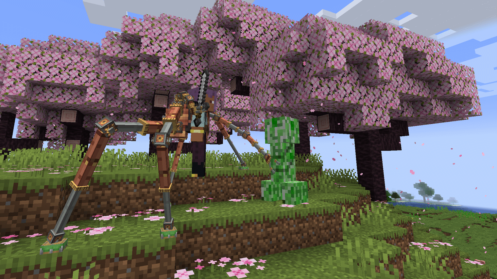
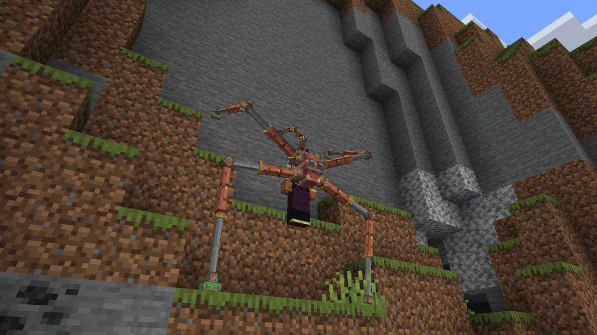
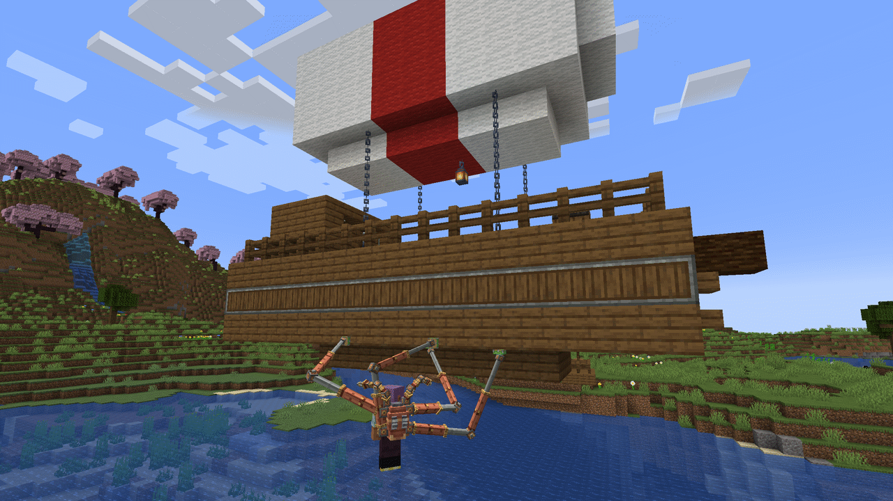
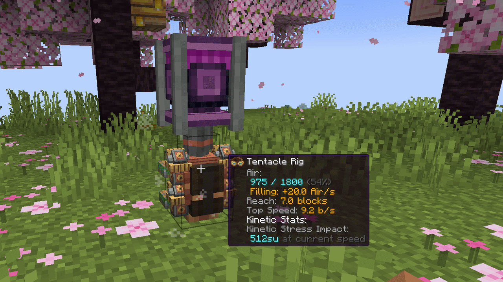

# Store texts for Octo Arms 2.0.0

Pasted by hand on Modrinth and CurseForge. The long description is Markdown: Modrinth takes it as is; on CurseForge pick the Markdown editor, or carry the changes into `publishing/curseforge-description.html`.

## Short description (summary, one line)

A Create Backtank with four pneumatic Tentacles and two Actuators. Climb walls, hang from ceilings, mine, grab and throw at a distance, ride Sable Ships.

## Long description

# Create: Octo Arms

**A Create Backtank with four pneumatic Tentacles and two Actuators. Climb walls, hang from ceilings, mine, grab and throw at a distance, ride Sable and Create Aeronautics Ships.**

## What it does

Craft a **Tentacle Rig**: a Backtank with four **Tentacles** and a Precision Mechanism. Wear it in the chest slot and **Double Jump**. The Tentacles grab nearby block faces and carry you where you look: across the floor, up a wall, under a ledge or a ceiling. Your hands stay free, so you can mine, build and fight while you hang. The Rig runs on the Backtank's **Air** and refills like any Backtank.

**New in 2.0: Actuators.** Fit two Actuators to the Rig and it gains hands: a Copper or Netherite **Octo Rig**. Each Actuator stands in for one of your hands and does whatever that hand does, farther: mining, placing, hitting and using out to the Rig's Reach (**Far Use**). Put a tool in each hand and both work at once (**Dual Wield**). A free Actuator **Grabs** a mob with the `V` key, holds it out of your way, sets it down where you look or **Throws** it, with Impact damage when it lands. With Sable the pair lifts a whole Ship.

## Features

- **Climb anything solid**: Tentacles grip block faces: floor, wall, ceiling, the underside of a ledge, slabs and stairs at their real height, also underwater.
- **Move where you look**: `Space` goes up, `Shift` goes down. The Rig only moves you where at least two Tentacles can hold, so you can't walk off an edge.
- **Double Jump** to activate, also in mid-air: the Rig catches you with no fall damage. Double Jump again to be **Set Down**.
- **Crawl**: out of Air, the Rig does not drop you. It slowly lowers you to the floor.
- **Hands free**: mining, placing, fighting and using items all work while the Rig carries you.
- **Actuators**: two extra arms above the Tentacles, fitted at a crafting table, one for each hand. They carry your items and do the work of your hands, Stowed or Active, on a Ride, gliding or Falling.
  - **Far Use**: blocks, mobs and players out to the Rig's Reach, as far as a Tentacle can grip. Never through a wall. Drops and XP fly to you. A Rig Setting turns it to Always, Rig out only or Off.
  - **Dual Wield**: two axes fell a tree twice as fast, two pickaxes mine at the sum of their speeds, an off-hand sword adds its damage to every hit.
  - **Grab** (`V`): any Actuator with an empty hand takes the mob, so you can hold a mob in one and keep a tool in the other. The mob is Pinned (no attacks, no Creeper fuse) and hangs low at your side, out of the crosshair. Shear, milk, name or leash it while you hold it.
  - **Set Down where you look**: tap `V` and the Actuator carries the mob to the outlined spot, also into a seat, boat or minecart. Hold `V` and scroll to move it nearer or farther.
  - **Throw**: attack while holding (with a tool in the main hand: `V` + attack). The mob flies along your view and takes Impact damage when it hits a block or another mob.
  - Heavy mobs (Iron Golem, Ravager, Horse, Enderman) take both Actuators and both empty hands, and slow you down. Players and bosses can't be Grabbed; claim mods are asked first.
  - **Crosshair marks** show what the Actuators will do before you click: in Reach, both working, just out of Reach, out of Air, grabbable and why not.
- **Still a Backtank**: it holds twice the Air of the Backtank it was made from, feeds a Diving Helmet, takes Capacity and refills under a spinning shaft.
- **Two tiers**: Copper (Reach 5) and Netherite (Reach 7, half the Air use, faster Throws, fire resistant).
- **Five enchantments**: Far Reach, Thrift, Swift, Silent Step (quiet for Sculk Sensors and Wardens) and Deft (the Actuators use no Air), plus vanilla chest armor enchantments.
- **Never breaks**: like an Elytra, a worn-out Rig stops at 1 durability until you repair it.
- **Rig Settings** screen: Standing Height, Speed, Activation Mode (Double Jump or a key) and Far Use.
- **Ride Ships**: works fully with Sable Ships, Create Aeronautics included. Tentacles grip Ship blocks like world blocks and carry you along with a moving, turning Ship.
- A stepping gait everyone on the server sees, Actuators that curl above your head and reach in from the side of the view, a first-person opacity slider for all arms, Sticker and piston sounds, and advancements from "Doc's Rig" to "Special Delivery".

## Quick start

1. Make **Tentacles** on a Sequenced Assembly line (Piston Extension Pole: deploy Sticker, press, deploy Andesite Casing, 2 loops).
2. Craft a **Copper Tentacle Rig** on Mechanical Crafters: four Tentacles, a Precision Mechanism, Brass Casing, Copper Sheet and a Copper Backtank. A new Rig has no Air.
3. Place the Rig as a block under a spinning shaft to fill it. Pick it up again with an empty hand.
4. Wear it in the chest slot and Double Jump. Look where you want to go and walk.
5. Double Jump again to be Set Down. Sneak + use the Rig in the air to open Rig Settings.
6. Make two **Actuators** (Piston Extension Pole: deploy Brass Casing, press, deploy Sticker, 2 loops) and put the Rig between them in one row of a crafting table. The Rig keeps its Air, enchantments and settings. Press `V` with an empty hand on a mob to Grab it, tap `V` to set it down where you look, attack to Throw it.

Ponder (hold `W` over a Rig or Tentacle) shows the Tentacles step by step.

## Ships (Sable, Create Aeronautics)

Octo Arms works fully with Sable Ships, and Create Aeronautics Ships are Sable Ships, so they are supported the same way. With Sable installed, the blocks of a Ship are Grips like world blocks. Grip a Ship's floor, walls, hull or underside, parked or moving, and move between the world and a Ship both ways. Air use counts only your own move.

With Actuators fitted, **Ship Grab** takes a whole Ship in both Actuators: it stays in front of you wherever you look, turns as you turn, moves nearer or farther with `V` and the wheel, and can be let go or thrown. The tier sets the heaviest Ship you can lift. Server admins can turn Ship Grips off with `ships.grip = false` and Ship Grab with `grab.ships = false`.

## Compatibility

- **Ponder** scene for the Tentacle Rig.
- **Engineer's Goggles**: Air, fill rate, Reach, Top Speed and Air use on a placed Rig Block.
- **Create Display Link**: a Rig Block is a "Rig Air" source for Display Boards and Nixie Tubes.
- **JEI** (optional): all recipes in Create's own categories, in Smithing and in Crafting.
- **Sable** (optional): full Ship support and Ship Grab, Create Aeronautics compatible.
- **Curios** (optional): the Rig fits the back slot, so a chestplate stays on. A Rig there is a Rig, not armor.
- **Claim and protection mods**: Grab and Far Use go through the loader's interaction events, so they can refuse them.

## Requirements

Two builds, same version number, same gameplay. Pick the file for your Minecraft version. Ships (Sable) and Ship Grab are 1.21.1 only.

| | Minecraft 1.21.1 | Minecraft 1.20.1 |
|---|---|---|
| Mod loader | NeoForge 21.1.228+ | Forge 47.1.3+ |
| Java | 21 | 17 |
| [Create](https://modrinth.com/mod/create) | 6.0.4+, below 6.1.0 | 6.0.4+, below 6.1.0 (6.0.8 is the last Create for 1.20.1) |
| [Sable](https://modrinth.com/mod/sable) | optional, 2.0.0+, below 2.1 (for Ships) | not available |
| [Curios](https://modrinth.com/mod/curios) | optional, 9.2.0+ (Rig in the back slot) | optional, 5.3.0+ (Rig in the back slot) |
| [JEI](https://modrinth.com/mod/jei) | optional | optional (15.x) |
| Jar | `octo-arms-<version>+mc1.21.1.jar` | `octo-arms-<version>+mc1.20.1.jar` |

Install on **both** client and server, same Octo Arms version and same Minecraft version on both: a 1.8 client cannot join a 2.0 server. The 1.20.1 build has no in-game config screen (the config files work the same).

Updating from 1.x: your Rigs keep working and can be fitted later. The Air cap doubles, so an old Rig shows its Air bar half full until you refill it once.

## Known limitations

- Nothing narrower than half a block (fence posts, chains) is a Grip.
- Mechanical Crafting does not copy the Backtank's Air, so a new Rig starts empty.
- A placed Rig Block does not show the Actuators, and the Ponder scene does not cover them yet.
- Ships with a scale other than 1 are ignored (1.21.1).
- Movement is client-driven and checked by the server. Not tested with server anti-cheat plugins or real network latency yet.

## Links

- [Source and docs](https://github.com/SenDeliver/create-octo-arms)
- [Issues](https://github.com/SenDeliver/create-octo-arms/issues)
- [Changelog](https://github.com/SenDeliver/create-octo-arms/blob/1.21.1/CHANGELOG.md)

MIT License. Built on Create (not bundled); uses Create's Backtank, Sticker and Ponder. Ship support through Sable (optional, not bundled). Developed with AI assistance (Claude); design, testing and direction by SenDeliver.
