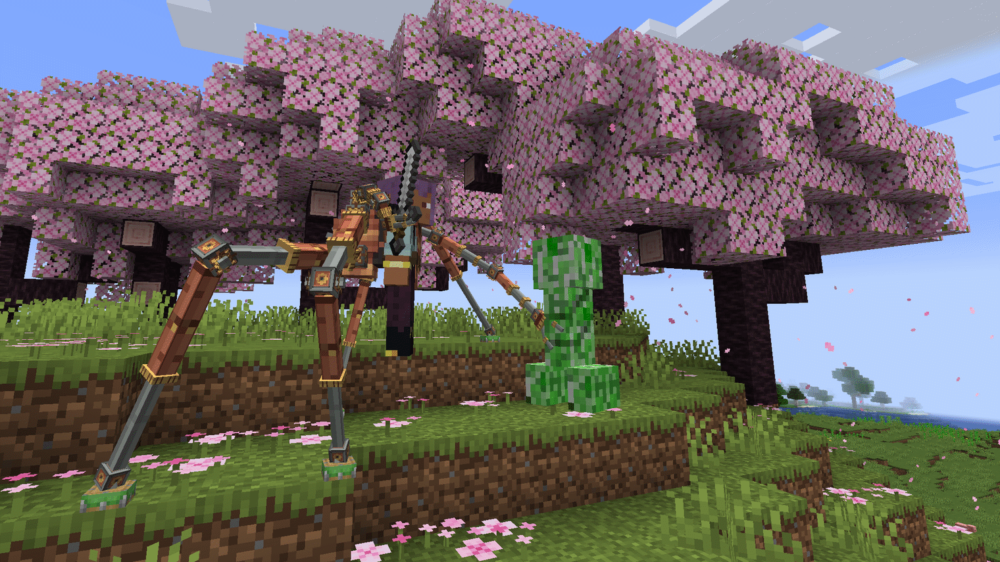
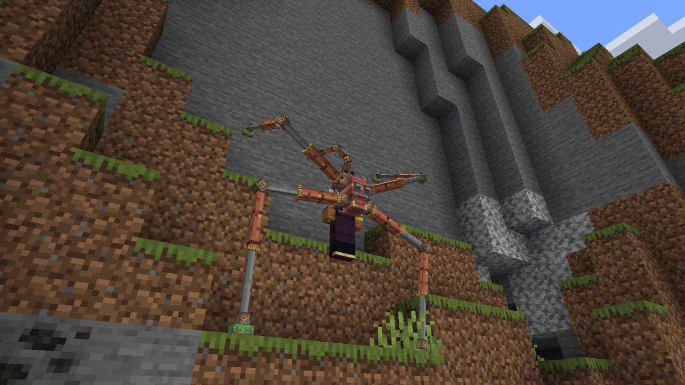
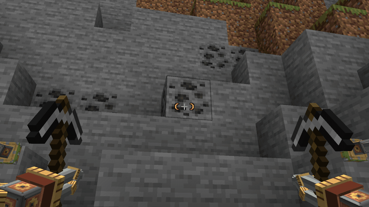
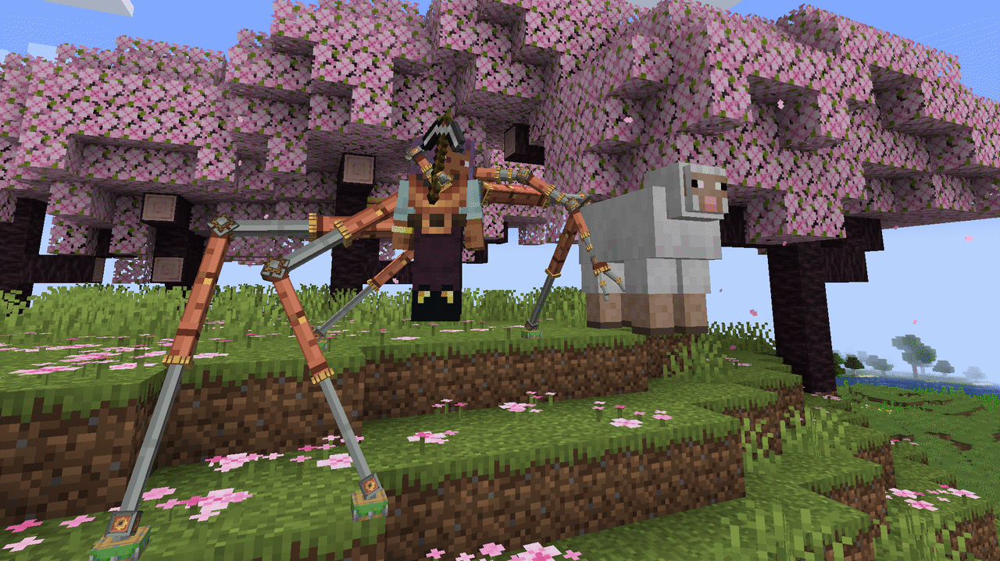
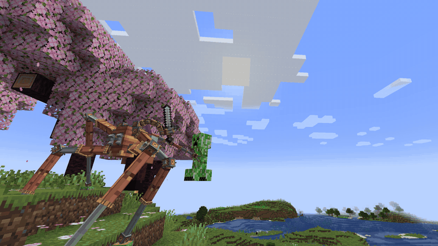
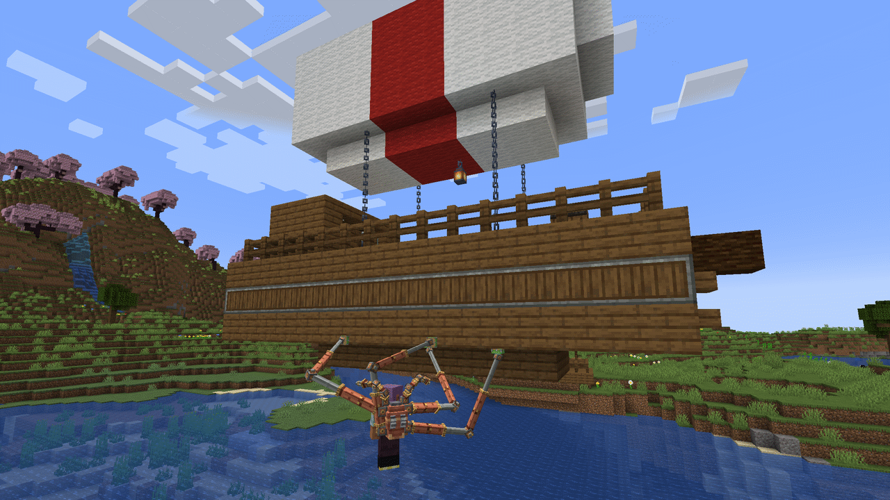
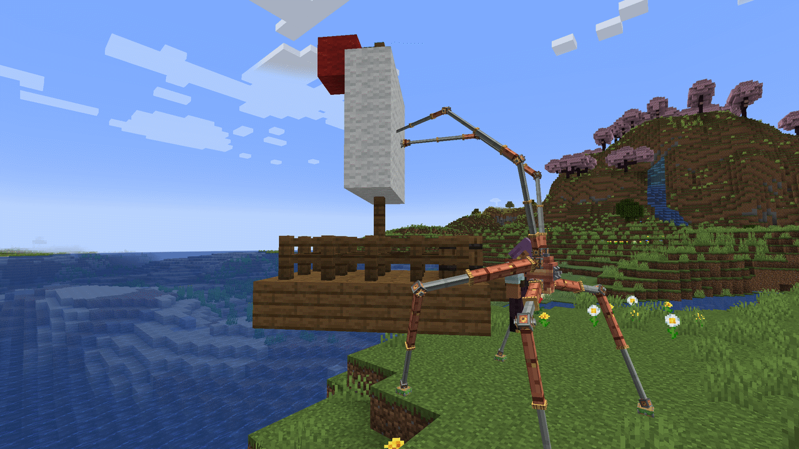
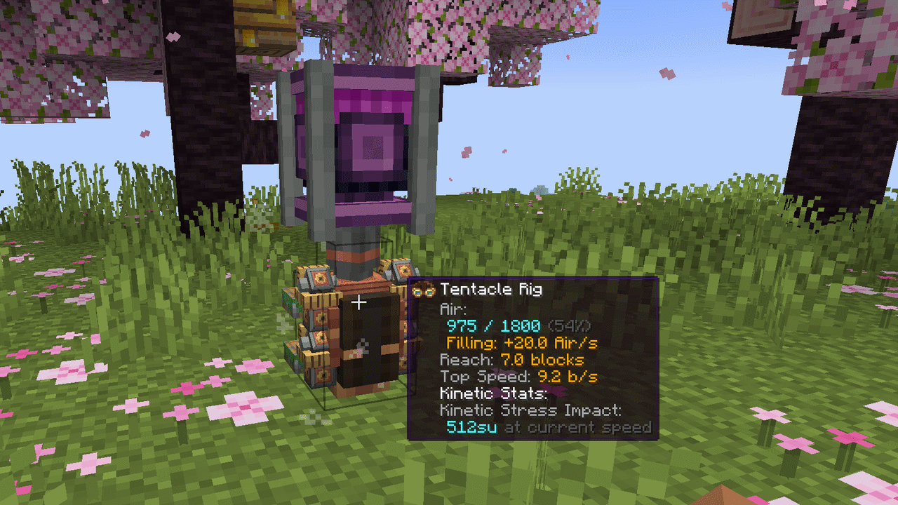

# Create: Octo Arms

**A Create Backtank with four pneumatic Tentacles and two Actuators. Climb walls, hang from ceilings, mine, grab and throw at a distance, ride Sable and Create Aeronautics Ships.**

## What it does

**Walk.** Craft a **Tentacle Rig**: a Backtank with four **Tentacles**. Wear it and **Double Jump**. The Tentacles grab nearby blocks and carry you where you look: across the floor, up a wall, under a ledge or a ceiling. Your hands stay free.

**Work.** New in 2.0: fit two **Actuators** and the Rig becomes an **Octo Rig**. Each Actuator is a hand. It carries that hand's item and does what the hand does, out to the Rig's Reach: mine, place, hit and use (**Far Use**). A tool in each hand and both work at once (**Dual Wield**). A free Actuator **Grabs** a mob with `V`, sets it down where you look or **Throws** it.

**Power.** The Rig runs on the Backtank's **Air** and refills under a spinning shaft, like any Backtank.

## Tentacles

- **Climb anything solid**: floors, walls, ceilings, the underside of a ledge, slabs and stairs at their real height, also underwater.
- **Move where you look**: `Space` goes up, `Shift` goes down. The Rig only moves you where at least two Tentacles can hold, so you can't walk off an edge.
- **Double Jump** to activate, also in mid-air: the Rig catches you with no fall damage. Double Jump again to be **Set Down**.
- **Crawl**: out of Air, the Rig does not drop you. It slowly lowers you to the floor.
- **Hands free**: mining, placing, fighting and using items all work while the Rig carries you.

## Actuators

- **Far Use**: blocks, mobs and players out to the Rig's Reach (Copper 5 blocks, Netherite 7). Never through a wall. Drops and XP fly to you.
- **Dual Wield**: two pickaxes mine at the sum of their speeds, two axes fell a tree twice as fast, an off-hand sword adds its damage to every hit.
- **Grab** (`V`): an Actuator with an empty hand takes the mob you look at and holds it at your side. The mob is Pinned: no attacks, no Creeper fuse. Your other hand keeps working.
- **Set Down**: tap `V` and the mob is put on the outlined spot, also into a seat, boat or minecart. Hold `V` and scroll to move it nearer or farther.
- **Throw**: attack while holding (with an item in the main hand: `V` + attack). The mob flies along your view and takes Impact damage when it hits a block or another mob.
- Big mobs (Iron Golem, Ravager, Horse, Enderman, Ghast) take both Actuators and both empty hands. Players and bosses can't be Grabbed. Claim mods are asked first.
- **Crosshair marks** show what the Actuators will do before you click.

## Controls

| Input | What it does |
|---|---|
| Double Jump | Activates the Rig. Again: Sets you Down |
| Look and walk, `Space`, `Shift` | Move where you look, up, down |
| Attack, Use | The hand's Actuator does it, out to Reach |
| `V` | Grab the mob you look at |
| Tap `V` while holding | Set Down where you look |
| Hold `V` + mouse wheel | Move what you hold nearer or farther |
| Attack while holding | Throw (with an item in the main hand: hold `V` + attack) |
| Sneak + Use the Rig item in the air | Rig Settings: Standing Height, Speed, Activation Mode, Far Use |

## More

- **Still a Backtank**: it holds twice the Air of the Backtank it was made from, feeds a Diving Helmet, takes Capacity and refills under a spinning shaft.
- **Two tiers**: Copper (Reach 5) and Netherite (Reach 7, half the Air use, faster Throws, fire resistant).
- **Five enchantments**: Far Reach, Thrift, Swift, Silent Step (quiet for Sculk Sensors and Wardens) and Deft (the Actuators use no Air), plus vanilla chest armor enchantments.
- **Never breaks**: like an Elytra, a worn-out Rig stops at 1 durability until you repair it.
- Everyone on the server sees the Rig step and work. Advancements from "Doc's Rig" to "Special Delivery".

## Quick start

1. Make **Tentacles** on a Sequenced Assembly line (Piston Extension Pole: deploy Sticker, press, deploy Andesite Casing, 2 loops).
2. Craft a **Copper Tentacle Rig** on Mechanical Crafters: four Tentacles, a Precision Mechanism, two Brass Casings, a Copper Sheet and a Copper Backtank. A new Rig has no Air.
3. Place the Rig as a block under a spinning shaft to fill it. Pick it up again with an empty hand.
4. Wear it in the chest slot and Double Jump. Look where you want to go and walk. Double Jump again to be Set Down.
5. Make two **Actuators** (Piston Extension Pole: deploy Brass Casing, press, deploy Sticker, 2 loops) and put the Rig between them in one row of a crafting table. The Rig keeps its Air, enchantments and settings.

JEI shows every recipe. Ponder (hold `W` over a Rig or Tentacle) shows the Tentacles step by step.

## Ships (Sable, Create Aeronautics)

1.21.1 only. With Sable installed, the blocks of a Ship are Grips like world blocks, and Create Aeronautics Ships are Sable Ships. Grip a Ship's floor, walls, hull or underside, parked or moving, and move between the world and a Ship both ways.

With Actuators fitted, **Ship Grab** takes a whole Ship in both Actuators: it follows your view, moves nearer or farther with `V` and the wheel, and can be let go or thrown. The tier sets the heaviest Ship you can lift. Server admins can turn Ship Grips off with `ships.grip = false` and Ship Grab with `grab.ships = false`.

## Compatibility

- **Ponder** scene for the Tentacle Rig.
- **Engineer's Goggles**: Air, fill rate, Reach and Top Speed on a placed Rig Block.
- **Create Display Link**: a Rig Block is a "Rig Air" source for Display Boards and Nixie Tubes.
- **JEI** (optional): all recipes in Create's own categories, in Smithing and in Crafting.
- **Sable** (optional): full Ship support and Ship Grab, Create Aeronautics compatible.
- **Curios** (optional): the Rig fits the back slot, so a chestplate stays on. A Rig there is a Rig, not armor.
- **Claim and protection mods**: Grab and Far Use go through the loader's interaction events, so they can refuse them.

## Requirements

Two builds, same version number, same gameplay. Pick the file for your Minecraft version. Ships (Sable) and Ship Grab are 1.21.1 only.

| | Minecraft 1.21.1 | Minecraft 1.20.1 |
|---|---|---|
| Mod loader | NeoForge 21.1.228+ | Forge 47.1.3+ |
| Java | 21 | 17 |
| [Create](https://modrinth.com/mod/create) | 6.0.4+, below 6.1.0 | 6.0.4+, below 6.1.0 (6.0.8 is the last Create for 1.20.1) |
| [Sable](https://modrinth.com/mod/sable) | optional, 2.0.0+, below 2.1 (for Ships) | not available |
| [Curios](https://modrinth.com/mod/curios) | optional, 9.2.0+ (Rig in the back slot) | optional, 5.3.0+ (Rig in the back slot) |
| [JEI](https://modrinth.com/mod/jei) | optional | optional (15.x) |
| Jar | `octo-arms-<version>+mc1.21.1.jar` | `octo-arms-<version>+mc1.20.1.jar` |

Install on **both** client and server, same Octo Arms version and same Minecraft version on both: a 1.8 client cannot join a 2.0 server. The 1.20.1 build has no in-game config screen (the config files work the same).

## Upgrading from 1.x to 2.0

- Nothing breaks: your world and your Rigs keep working. Still, make a backup first.
- Update the server and every client together.
- An old Rig stays as it is. To get the new arms, craft it with two **Actuators**: it becomes an Octo Rig and keeps everything.
- Grab is on `V`. Make sure no other mod uses that key.

## Known limitations

- Nothing narrower than half a block (fence posts, chains) is a Grip.
- Mechanical Crafting does not copy the Backtank's Air, so a new Rig starts empty.
- A placed Rig Block does not show the Actuators, and the Ponder scene does not cover them yet.
- Ships with a scale other than 1 are ignored (1.21.1).
- Movement is client-driven and checked by the server. Not tested with server anti-cheat plugins or real network latency yet.

## Links

- [Source and docs](https://github.com/SenDeliver/create-octo-arms)
- [Issues](https://github.com/SenDeliver/create-octo-arms/issues)
- [Changelog](https://github.com/SenDeliver/create-octo-arms/blob/1.21.1/CHANGELOG.md)

MIT License. Built on Create (not bundled); uses Create's Backtank, Sticker and Ponder. Ship support through Sable (optional, not bundled). Developed with AI assistance (Claude); design, testing and direction by SenDeliver.
